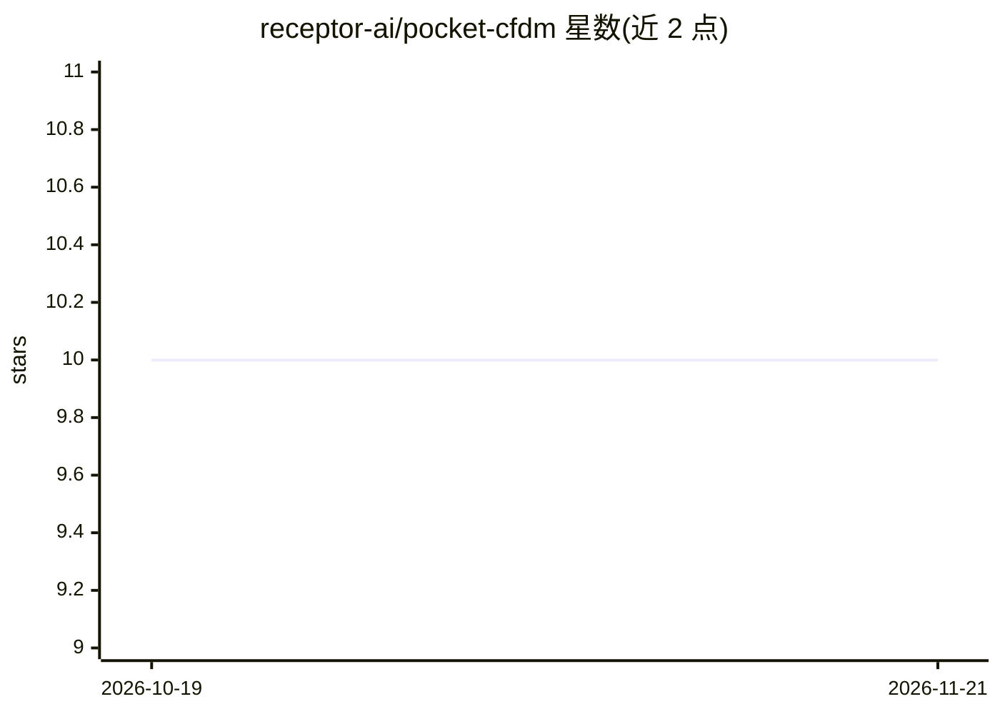

# receptor-ai/pocket-cfdm

⭐ 10 · Python · MIT · 推送 2026-07-17 · [GitHub](https://github.com/receptor-ai/pocket-cfdm) · [官网](https://doi.org/10.1039/D3RA08147H) · 个人维护

**为科研人员生成分子对接构象的等变扩散模型工具**

复现论文的人工口袋增强分子对接扩散模型：读取仅含口袋残基的 PDB 文件与候选配体 SDF，运行推理生成小分子在预定义结合口袋中的对接构象，并按质量过滤输出结果；可通过 samples 参数增加备选构象数。提供源码与 Docker 两种运行方式，依赖 PyTorch/PyTorch Geometric 及 GPU；首次运行需预计算并缓存数据分布。

## 筛选速览

| 维度 | 判定 | 备注 |
|---|---|---|
| AI 角色 | `ai-native` | 本体是模型或模型工具 |
| 许可风险 | `permissive` | MIT |
| 部署形态 | `self-host` | docker 或自建部署 |
| 模型依赖 | — | README 未给出锁定关系 |
| 硬件要求 | — | 无带数字的原话,不猜 |
| 安装摩擦 | `low` | 无编译、无系统依赖或容器化 |
| 成熟度 | — | 结构信号不足 |

## 能力要点

- 读取口袋 PDB 与配体 SDF，生成分级过滤后的对接构象 SDF
- samples 参数控制每分子生成的备选构象数量
- 提供 Docker 镜像（--gpus all）与源码两种运行路径
- 附带口袋提取示例脚本 extract_pocket.py

## 适用场景

- 在已知结合口袋中对小分子配体批量生成对接构象
- 复现论文中人工口袋增强的扩散模型对接实验
- 在指定口袋上探索配体的多种备选结合姿态

## 场景标签

`科研工具` · 领域:学习与行业

## 证据(README 行号)

> L6: The model is trained to dock small molecules in a predefined binding pocket.
> L24: 4. Run the inference
> L25: `python predict.py --pdb my_pocket.pdb --sdf my_ligands.sdf --save_path my_ligands_docked.sdf --samples 16 --batch_

## 星数曲线

2026-10-19 10 → 2026-11-21 10（+0）

---
*卡片 v1 · prompt 1.4 · 生成 2026-11-19 · 置信度 high · 依据 README sha `c1fb2e4f8c6f` · [字段定义](../../DATASET.md)*
