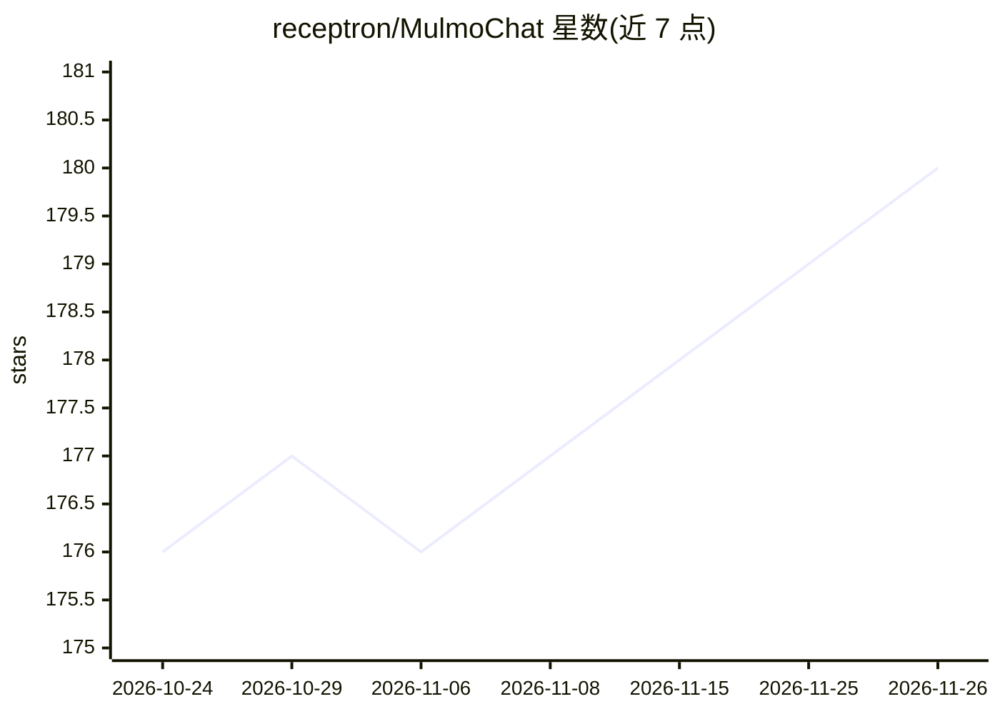

# receptron/MulmoChat

⭐ 180 · TypeScript · MIT · 推送 2026-11-24 · [GitHub](https://github.com/receptron/MulmoChat) · 组织维护 · 中文 README

**多模态语音聊天研究原型：对话时画布上生成图像/地图/游戏**

TypeScript + Vue 构建的多模态 AI 聊天研究原型，探索非纯文本流式交互：用户持续语音对话的同时，画布上呈现图像、可交互地图与可玩游戏。每类回答以 GUI Chat Protocol 插件形式接入。文本生成 API 采用 provider 无关设计，支持 OpenAI、Anthropic、Google Gemini 与 Ollama；图像可经 ComfyUI Desktop 本地生成（FLUX/SD 模型）；语音可接 llama.cpp 运行本地 LFM3 Omni 2B 模型，该模式无需云端 API key。歌声合成依赖需自行安装的 NEUTRINO（可选）。

## 筛选速览

| 维度 | 判定 | 备注 |
|---|---|---|
| AI 角色 | `ai-native` | 本体是模型或模型工具 |
| 许可风险 | `permissive` | MIT |
| 部署形态 | `library` | 以包/库形式分发 |
| 模型依赖 | local-ok | 支持本地模型 |
| 硬件要求 | — | 无带数字的原话,不猜 |
| 安装摩擦 | `low` | 无编译、无系统依赖或容器化 |
| 成熟度 | `idea` | |

## 能力要点

- 语音对话中画布同步呈现图像、地图与可玩游戏
- provider 无关文本 API：OpenAI/Anthropic/Gemini/Ollama 统一接口
- ComfyUI Desktop 本地图像生成集成（FLUX/SD 自动参数适配）
- llama.cpp 本地语音模式（LFM3 Omni 2B），无需云端 LLM key

## 适用场景

- 探索多模态对话界面与 generative UI 的设计模式
- 为聊天应用开发新的 GUI 插件能力
- 用本地模型搭建无需云端 API key 的语音助手实验环境

## 场景标签

`语音 Agent` `图像生成` `多模态` `AI 助手` · 领域:对话与助手

## 证据(README 行号)

> L3: **MulmoChat is a research prototype exploring a new paradigm for multimodal AI chat experiences.**
> L7: The key insight: **AI conversations don't have to be limited to text streams.** By designing an architecture where v

## 星数曲线

2026-10-24 176 → 2026-11-26 180（+4）

---
*卡片 v1 · prompt 1.4 · 生成 2026-11-26 · 置信度 mid · 依据 README sha `33d15a151f35` · [字段定义](../../DATASET.md)*
