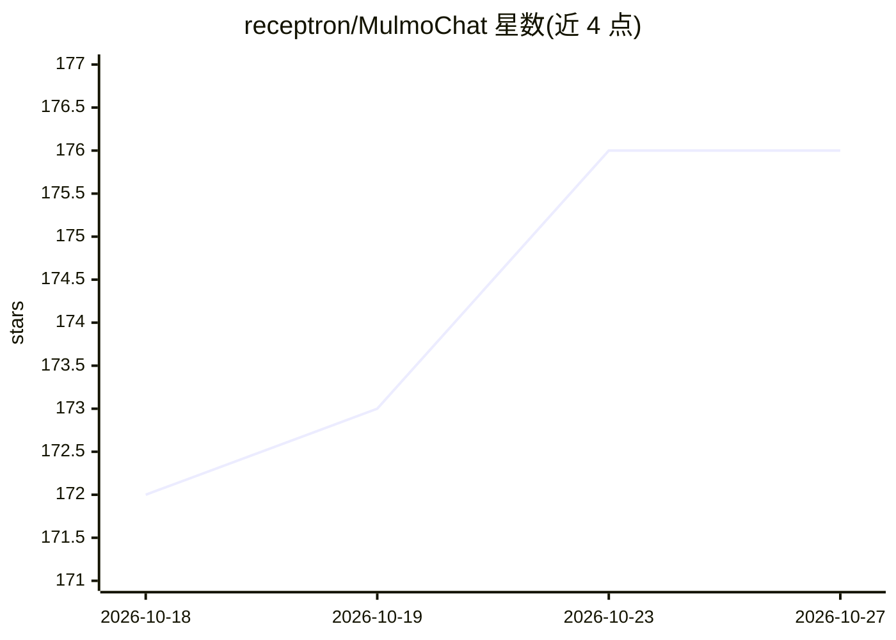

# receptron/MulmoChat

⭐ 176 · TypeScript · MIT · 推送 2026-10-23 · [GitHub](https://github.com/receptron/MulmoChat) · 组织维护

**研究原型：多模态 AI 对话应用，画布呈现图像/地图/游戏**

MulmoChat 是一个探索非文本流式对话的研究原型：用户通过语音或文本对话，同时在画布上获得图像、可探索地图与可玩游戏的输出，每种回答类型对应 GUI Chat Protocol 的一个插件。提供与厂商无关的文本生成 API（OpenAI/Anthropic/Gemini/Ollama），并集成 ComfyUI Desktop 实现本地图像生成（FLUX/SD 模型，参数自动选优）。用 TypeScript/Vue 构建，通过 yarn 安装依赖并运行开发服务器，配置各厂商 API key 后可用。

## 筛选速览

| 维度 | 判定 | 备注 |
|---|---|---|
| AI 角色 | `ai-native` | 本体是模型或模型工具 |
| 许可风险 | `permissive` | MIT |
| 部署形态 | `library` | 以包/库形式分发 |
| 模型依赖 | local-ok | 支持本地模型 |
| 硬件要求 | — | 无带数字的原话,不猜 |
| 安装摩擦 | `low` | 无编译、无系统依赖或容器化 |
| 成熟度 | `idea` | |

## 能力要点

- 对话同时画布呈现图像、地图与可玩游戏，答案类型为 GUI Chat Protocol 插件
- 厂商无关的文本生成 API：OpenAI/Anthropic/Google Gemini/Ollama
- 集成 ComfyUI Desktop 本地图像生成，支持 FLUX/SD 模型并自动选参
- 语音对话入口（浏览器麦克风权限）

## 适用场景

- 用语音与 AI 对话并直接在画布获得图像、地图等富内容
- 本地通过 ComfyUI+FLUX 生成图像替代云端方案
- 研究者参考其多模态聊天架构与插件设计模式
- 通过统一文本 API 对多家厂商模型发起调用

## 场景标签

`多模态` `图像生成` · 领域:内容生成

## 证据(README 行号)

> L3: **MulmoChat is a research prototype exploring a new paradigm for multimodal AI chat experiences.**
> L48: Click the "Start Voice Chat", and start talking to the AI, which has a capability to generate images.
> L52: MulmoChat now exposes a provider-agnostic text generation API that can be consumed by the client or external integr

## 星数曲线

2026-10-18 172 → 2026-10-27 176（+4）

---
*卡片 v1 · prompt 1.4 · 生成 2026-10-23 · 置信度 mid · 依据 README sha `cbddb091ea06` · [字段定义](../../DATASET.md)*
