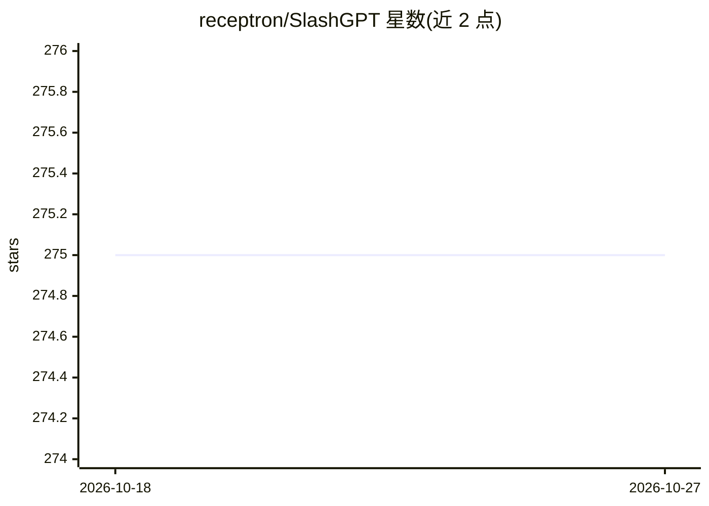

# receptron/SlashGPT

⭐ 275 · Jupyter Notebook · MIT · 推送 2026-05-12 · [GitHub](https://github.com/receptron/SlashGPT) · 个人维护

**开发者快速原型化 LLM agent 的命令行 playground**

一个用于快速制作 LLM agent 原型的 Python 运行环境：新增 agent 只需在 manifests 目录添加 JSON/YAML 清单文件（含系统提示词、模型、函数定义等约 25 个可选属性），在会话中输入 /{agent_name} 即可切换。内置 dispatcher agent 路由用户消息，Actions 机制支持以模板方式定义 message_template/REST/GraphQL/data_url/emit 五类函数实现，无需写 Python 代码；可运行生成的 Python 代码模拟 Code Interpreter（GPT-3.5 路径可自动执行，PaLM2/LlaMA 路径需手动触发）。提供 Docker 与 Colab 运行方式，会话记录存为 JSON，Code Interpreter agent 生成 Jupyter notebook。

## 筛选速览

| 维度 | 判定 | 备注 |
|---|---|---|
| AI 角色 | `ai-ecosystem` | LLM/agent 周边工具 |
| 许可风险 | `permissive` | MIT |
| 部署形态 | `self-host` | docker 或自建部署 |
| 模型依赖 | — | README 未给出锁定关系 |
| 硬件要求 | — | 无带数字的原话,不猜 |
| 安装摩擦 | `low` | 无编译、无系统依赖或容器化 |
| 成熟度 | — | 结构信号不足 |

## 能力要点

- 新增 agent 仅需一个 JSON/YAML manifest 文件，/name 即时切换
- dispatcher agent 将用户消息路由到合适的 agent
- Actions 模板定义函数实现：message_template/REST/GraphQL/data_url/emit
- code agent 在 IPython 或 CodeBox 运行中生成 Python 代码并生成 notebook

## 适用场景

- 不写代码快速试验一个新 LLM agent 的提示词与函数调用
- 在后端就绪前用 message_template 做 mock 前端验证
- 把 ChatGPT 插件类 REST/GraphQL API 集成为 agent

## 场景标签

`Agent 框架` `提示工程` · 领域:Agent 开发

## 证据(README 行号)

> L3: SlashGPT is a playground for developers to make quick prototypes of LLM agents
> L10: 1. Extremely easy to create a new LLM agent. You just need to add a new
> L16: 5. It enables broker agent (or dispatcher), which routes user's message to an

## 星数曲线

2026-10-18 275 → 2026-10-27 275（+0）

---
*卡片 v1 · prompt 1.4 · 生成 2026-10-22 · 置信度 high · 依据 README sha `ceccb8a35b0c` · [字段定义](../../DATASET.md)*
