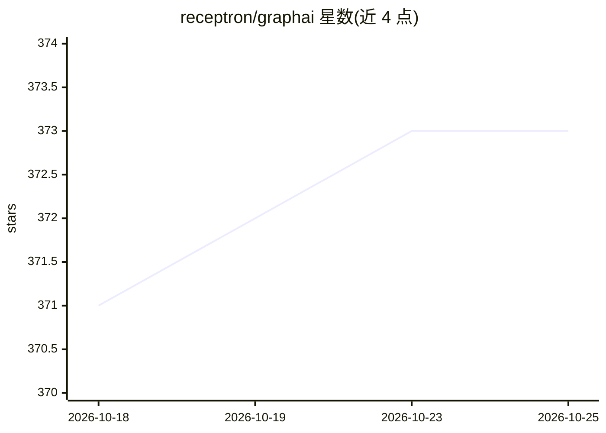

# receptron/graphai

⭐ 373 · TypeScript · MIT · 推送 2026-10-21 · [GitHub](https://github.com/receptron/graphai) · [官网](https://graphai.info) · 组织维护

**异步数据流执行引擎：用 YAML/JSON 声明式构建 agent 应用**

GraphAI 是一个 TypeScript/Node.js 的异步数据流执行引擎，开发者以 YAML 或 JSON 声明数据流图来描述 agent 工作流，用于构建 agentic 应用与多 agent 编排。以 npm 包（graphai）及 graphai 组织下的一组 agent 包、receptron 组织下的工具包形式分发，配套 GraphAI CLI、TypeScript API 文档（含 typedoc）、面向开发者与终端用户的示例集，以及 Web 演示和 Grapys 图形界面工具。README 提及 Mulmocast 作为用例：一个从脚本文件生成播客与视频内容的 CLI 工具。另列出科学论文（SPECS）。

## 筛选速览

| 维度 | 判定 | 备注 |
|---|---|---|
| AI 角色 | `ai-ecosystem` | LLM/agent 周边工具 |
| 许可风险 | `permissive` | MIT |
| 部署形态 | `None` |  |
| 模型依赖 | — | README 未给出锁定关系 |
| 硬件要求 | — | 无带数字的原话,不猜 |
| 安装摩擦 | `low` | 无编译、无系统依赖或容器化 |
| 成熟度 | — | 结构信号不足 |

## 能力要点

- 以 YAML/JSON 声明式数据流图描述 agent 工作流
- 异步执行引擎，TypeScript/Node.js 实现
- 配套 CLI、API 文档、开发者/终端用户示例集与 Web 演示
- npm 发布 graphai 包及 graphai/receptron 组织下的 agent 与工具包

## 适用场景

- 用声明式图编排多 agent 工作流
- 构建依赖异步数据流的 agentic 应用
- 通过示例与 Web 演示学习 agent 工作流编排

## 场景标签

`Agent 框架` `多智能体` · 领域:Agent 开发

## 证据(README 行号)

> L8: GraphAI is an asynchronous data flow execution engine, which allows developers to build *agentic applications* by de
> L57: ### GraphAI Agents

## 星数曲线

2026-10-18 371 → 2026-10-25 373（+2）

---
*卡片 v1 · prompt 1.4 · 生成 2026-10-22 · 置信度 high · 依据 README sha `7385b164ce7e` · [字段定义](../../DATASET.md)*
