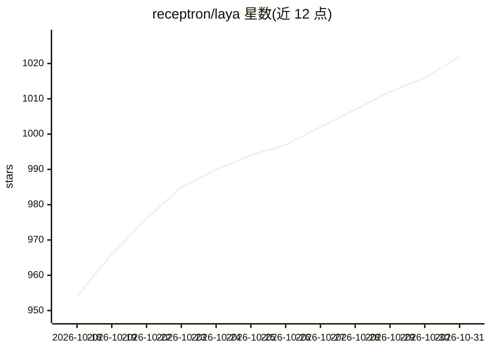

# receptron/laya

⭐ 1,022 · TypeScript · MIT · 推送 2026-10-17 · [GitHub](https://github.com/receptron/laya) · [官网](https://www.npmjs.com/package/@receptron/laya) · 组织维护

**Node.js/TypeScript 运行 Laya System-1 决策模型的 ONNX 封装**

通过 ONNX Runtime 在 Node.js/TypeScript 中运行 Convai Innovations 的 Laya（Jev 兼容的 System 1 决策模型）。模型不生成文本：输入状态（工单、邮件、JSON）与类型化问题，一次前向返回带校准概率的答案，支持 choice（选项概率）、score（有序量表分布）、noul（P(true)）三种类型。运行时无需 PyTorch/Python，输出与 Python 参考实现精确到小数点后四位。权重约 1.7 GB，首次从 Hugging Face 下载并缓存；限制包括选项须在 192 token 内、状态截断至 512 token、温度钳制在 [0.5, 5]。

## 筛选速览

| 维度 | 判定 | 备注 |
|---|---|---|
| AI 角色 | `ai-native` | 本体是模型或模型工具 |
| 许可风险 | `permissive` | MIT |
| 部署形态 | `library` | 以包/库形式分发 |
| 模型依赖 | — | README 未给出锁定关系 |
| 硬件要求 | — | 无带数字的原话,不猜 |
| 安装摩擦 | `low` | 无编译、无系统依赖或容器化 |
| 成熟度 | — | 结构信号不足 |

## 能力要点

- choice/score/noul 三种校准概率输出，一次前向完成
- ONNX Runtime 运行，无需 PyTorch/Python，输出与 Python 实现对齐至四位小数
- 权重自动从 Hugging Face 下载缓存，可 ensureBundle() 预取
- 提供自行导出 ONNX bundle 的脚本与本地 modelDir 加载选项

## 适用场景

- 在 Node.js 服务中对工单/邮件等状态做分类、打分与真伪判定
- 本地运行决策模型，不依赖外部 LLM API
- 在生产镜像构建阶段预取模型权重以缩短冷启动

## 场景标签

`推理引擎` · 领域:训练与推理

## 证据(README 行号)

> L6: Laya does not generate text. You hand it a state (a ticket, an email, a JSON object) and typed
> L7: questions, and it returns every answer with calibrated probabilities in **one forward pass**:
> L9: - `choice` — pick one option, with a probability per option
> L13: This package runs the model with ONNX Runtime; PyTorch and Python are

## 星数曲线

2026-10-18 954 → 2026-10-31 1,022（+68）

---
*卡片 v1 · prompt 1.4 · 生成 2026-10-21 · 置信度 mid · 依据 README sha `3d0c191d878a` · [字段定义](../../DATASET.md)*
