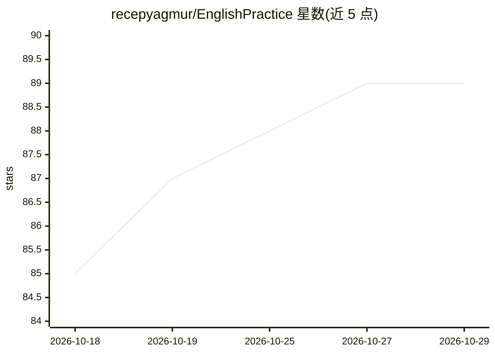

# recepyagmur/EnglishPractice

⭐ 89 · Python · MIT · 推送 2026-10-26 · [GitHub](https://github.com/recepyagmur/EnglishPractice) · 个人维护

**面向土耳其语使用者的离线便携英语练习应用**

完全离线、便携的英语口语/写作练习应用，面向土耳其语使用者尤其是在职成人。功能包括与本地 AI 语音或文字对话并即时纠错（A1–C1 课程与等级考试、50 节手写课程）、土耳其语答疑的教师页、单词与短语练习（含最常用 3000 词）、间隔重复复习（1天至4月递增间隔）、YDS 风格限时测验、进度统计与双机同步。技术栈为内嵌 Ollama + Gemma 语言模型、Whisper 语音识别（置信度<60% 标黄）、Kokoro TTS；所有组件（含便携 Python）置于同一文件夹，不向系统安装任何内容，Windows 10/11 与 Linux 可运行。

## 筛选速览

| 维度 | 判定 | 备注 |
|---|---|---|
| AI 角色 | `ai-native` | 本体是模型或模型工具 |
| 许可风险 | `permissive` | MIT |
| 部署形态 | `desktop` | 安装包/桌面程序 |
| 模型依赖 | local-ok | 支持本地模型 |
| 硬件要求 | — | 无带数字的原话,不猜 |
| 安装摩擦 | `medium` | 含编译或系统依赖之一 |
| 成熟度 | — | 结构信号不足 |

## 能力要点

- 本地 AI 对话加逐句即时纠错（错误类型标签与更自然说法）
- 内嵌 Ollama/Gemma/Whisper/Kokoro，安装后无需联网、数据不出本机
- A1–C1 共 50 节手写课程与间隔重复复习（spacing effect）
- 跨电脑便携：换机时仅重选模型并做速度测试，已下载模型不重复下载

## 适用场景

- 在职成人利用碎片时间离线练英语口语和写作
- 系统学习 A1–C1 语法并通过间隔重复巩固
- YDS 备考做限时练习并跟踪薄弱点

## 场景标签

 · 领域:语言学习/教育

## 证据(README 行号)

> L3: Tamamen ücretsiz, çevrimdışı ve **taşınabilir** İngilizce konuşma/yazma pratiği uygulaması.
> L6: Türkçe konuşan, özellikle çalışan yetişkinler için: yerel bir yapay zekâyla sesli ya da yazılı İngilizce sohbet ve a
> L69: **`Baslat.bat`'a çift tıklayın.** Uygulama içindeki Ollama'yı başlatır, modeli belleğe yükler ve

## 星数曲线

2026-10-18 85 → 2026-10-29 89（+4）

---
*卡片 v1 · prompt 1.4 · 生成 2026-10-23 · 置信度 mid · 依据 README sha `2e1d48fb1abd` · [字段定义](../../DATASET.md)*
