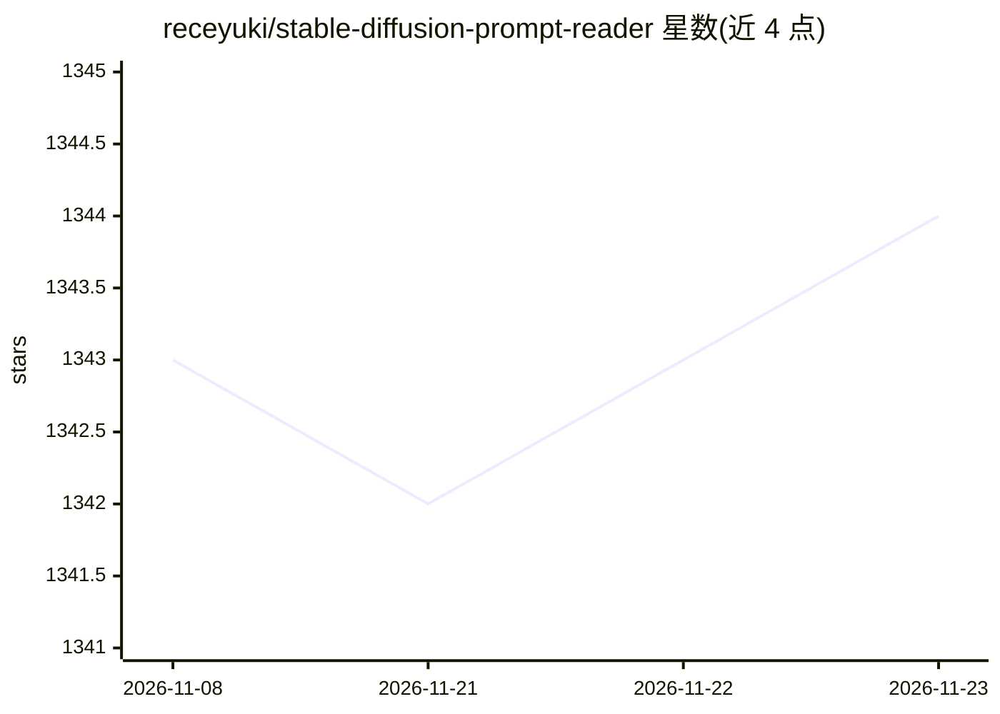

# receyuki/stable-diffusion-prompt-reader

⭐ 1,344 · Python · MIT · 推送 2026-11-18 · [GitHub](https://github.com/receyuki/stable-diffusion-prompt-reader) · 个人维护 · 中文 README

**读取 SD 生成图片中提示词的独立查看器**

在 webui 之外读取 Stable Diffusion 生成图片内嵌提示词的工具：解析 A1111、ComfyUI、NovelAI、InvokeAI、Easy Diffusion、Fooocus-MRE 等工具生成的 PNG/JPEG/WEBP 元数据，支持复制提示词、导出 txt、清除图片元数据、编辑并写回提示词（统一转为 A1111 格式），并自动识别生成工具。提供 GUI、CLI（读/写/清三种模式）与 Python API，另有 ComfyUI 节点子项目。限制：ComfyUI 自定义节点或复杂工作流可能无法正确读取。

## 筛选速览

| 维度 | 判定 | 备注 |
|---|---|---|
| AI 角色 | `ai-ecosystem` | LLM/agent 周边工具 |
| 许可风险 | `permissive` | MIT |
| 部署形态 | `desktop` | 安装包/桌面程序 |
| 模型依赖 | — | README 未给出锁定关系 |
| 硬件要求 | — | 无带数字的原话,不猜 |
| 安装摩擦 | `low` | 无编译、无系统依赖或容器化 |
| 成熟度 | — | 结构信号不足 |

## 能力要点

- 解析 10 种生成工具的图片元数据并检测生成工具
- GUI 拖拽交互，另提供读/写/清三种模式的 CLI 与 Python API
- 支持清除、编辑提示词并写回图片
- 提供 ComfyUI Prompt Reader Node 子项目

## 适用场景

- 查看别人分享的 AI 图片用了什么提示词和参数
- 发布作品前清除图片中的元数据
- 把图片中的提示词导出为 txt 或单行格式复用

## 场景标签

`图像生成` · 领域:内容生成

## 证据(README 行号)

> L17: A simple standalone viewer for reading prompt from Stable Diffusion generated image outside the webui.
> L32: ## Features

## 星数曲线

2026-11-08 1,343 → 2026-11-23 1,344（+1）

---
*卡片 v1 · prompt 1.4 · 生成 2026-11-23 · 置信度 mid · 依据 README sha `e357a60a00f4` · [字段定义](../../DATASET.md)*
