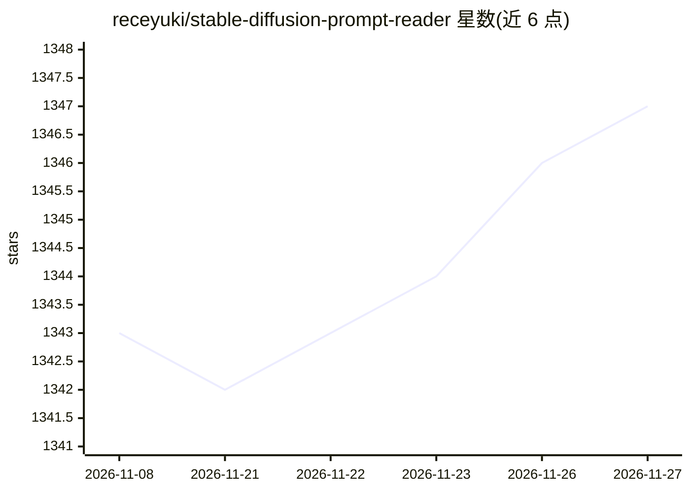

# receyuki/stable-diffusion-prompt-reader

⭐ 1,347 · Python · MIT · 推送 2026-11-23 · [GitHub](https://github.com/receyuki/stable-diffusion-prompt-reader) · 个人维护 · 中文 README

**读取 Stable Diffusion 生成图像中提示词的独立查看器**

独立于 webui 运行的提示词查看工具，从 Stable Diffusion 各工具生成的图像中读取嵌入的元数据与提示词；提供 GUI（拖拽交互）与 CLI 两种形态，支持读取、导出为 TXT/JSON、编辑/写入、清除元数据，并可检测生成工具类型；覆盖 A1111、ComfyUI、NovelAI、InvokeAI、Fooocus 等十余种格式的 PNG/JPEG/WEBP/TXT 文件。Windows/macOS 提供可执行文件，Linux 经 pip 或源码运行；ComfyUI 复杂工作流、自定义节点场景可能无法正确读取。

## 筛选速览

| 维度 | 判定 | 备注 |
|---|---|---|
| AI 角色 | `ai-ecosystem` | LLM/agent 周边工具 |
| 许可风险 | `permissive` | MIT |
| 部署形态 | `desktop` | 安装包/桌面程序 |
| 模型依赖 | — | README 未给出锁定关系 |
| 硬件要求 | — | 无带数字的原话,不猜 |
| 安装摩擦 | `low` | 无编译、无系统依赖或容器化 |
| 成熟度 | — | 结构信号不足 |

## 能力要点

- 读取十余种生成工具格式的图像内嵌提示词元数据
- 提供 GUI 与 CLI：读取、导出、编辑写入、清除元数据
- 支持导出可粘贴回 webui 的单行 prompt 及生成参数
- 另有可嵌入工作流的 ComfyUI Prompt Reader 子项目节点

## 适用场景

- 查看别人分享的 SD 图片用了什么提示词和参数
- 分享图片前清除内嵌元数据
- 把已有图片的提示词复制成单行以便在 webui 复现
- 批量整理图像元数据并导出为 TXT/JSON

## 场景标签

`提示工程` `图像生成` · 领域:Agent 开发

## 证据(README 行号)

> L17: A simple standalone viewer for reading prompt from Stable Diffusion generated image outside the webui.
> L32: ## Features
> L186: A CLI tool for reading, modifying, and clearing metadata is provided.

## 星数曲线

2026-11-08 1,343 → 2026-11-27 1,347（+4）

---
*卡片 v1 · prompt 1.4 · 生成 2026-11-24 · 置信度 high · 依据 README sha `47916f24c79b` · [字段定义](../../DATASET.md)*
