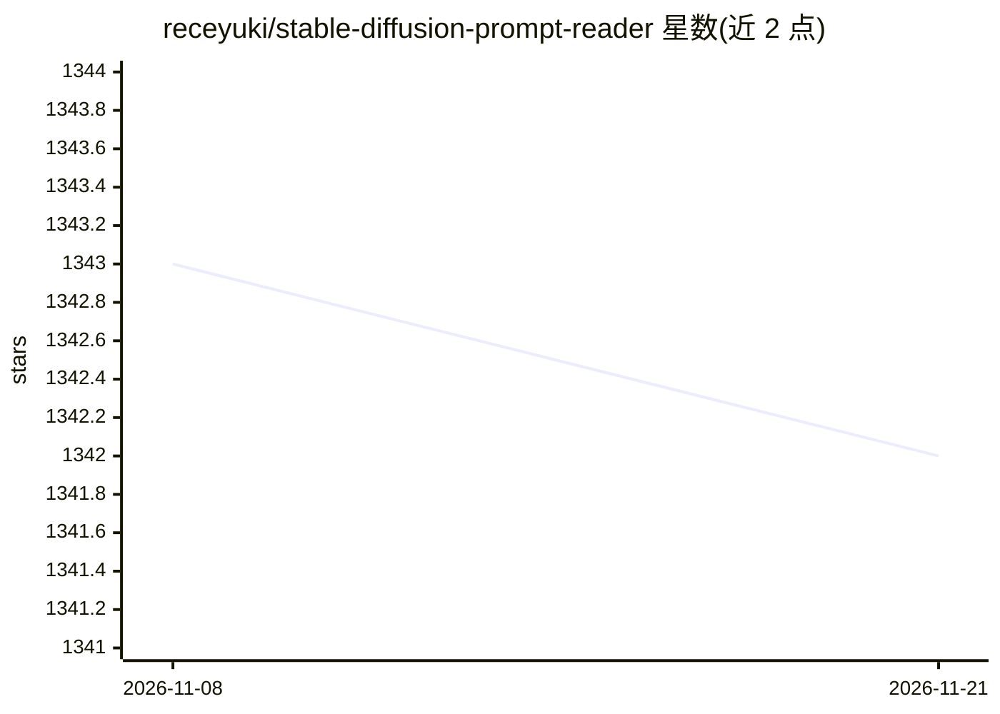

# receyuki/stable-diffusion-prompt-reader

⭐ 1,342 · Python · MIT · 推送 2026-11-18 · [GitHub](https://github.com/receyuki/stable-diffusion-prompt-reader) · 个人维护 · 中文 README

**读取 Stable Diffusion 生成图片中提示词的独立查看器**

供 Stable Diffusion 用户在 webui 之外读取生成图片内嵌提示词与参数的独立工具，提供 GUI 与 CLI 两种形式，支持拖拽交互、复制提示词、导出 txt、编辑/导入元数据、清除图片元数据、检测生成工具来源。兼容 A1111 webUI、ComfyUI、NovelAI、InvokeAI 等十余种工具的 PNG/JPEG/WEBP 格式，另以子项目形式提供 ComfyUI 节点与 Python API。限制：TXT 仅支持 A1111 格式，编辑后的图片均写为 A1111 格式。

## 筛选速览

| 维度 | 判定 | 备注 |
|---|---|---|
| AI 角色 | `ai-enhanced` | 去掉 AI 部分产品仍成立 |
| 许可风险 | `permissive` | MIT |
| 部署形态 | `desktop` | 安装包/桌面程序 |
| 模型依赖 | — | README 未给出锁定关系 |
| 硬件要求 | — | 无带数字的原话,不猜 |
| 安装摩擦 | `low` | 无编译、无系统依赖或容器化 |
| 成熟度 | — | 结构信号不足 |

## 能力要点

- GUI 与 CLI 双形式，支持读/写/清除三种元数据操作
- 兼容 A1111、ComfyUI、NovelAI（stealth pnginfo）、InvokeAI 等十余种生成工具的格式
- 支持 ComfyUI SDXL 多组提示词（Clip G/Clip L/Refiner）显示
- 提供 Python API（ImageDataReader）与 ComfyUI 节点子项目

## 适用场景

- 离线查看 Stable Diffusion 图片里的提示词和生成参数
- 批量导出或清除图片元数据，或编辑后重新写入
- 把图片提示词复制回 webui 的 Prompts from file or textbox 复用

## 场景标签

`图像视频处理` · 领域:感知与多模态

## 证据(README 行号)

> L17: A simple standalone viewer for reading prompt from Stable Diffusion generated image outside the webui.
> L34: - Provides both GUI and CLI

## 星数曲线

2026-11-08 1,343 → 2026-11-21 1,342（-1）

---
*卡片 v1 · prompt 1.4 · 生成 2026-11-17 · 置信度 high · 依据 README sha `245b5a5ff0e2` · [字段定义](../../DATASET.md)*
