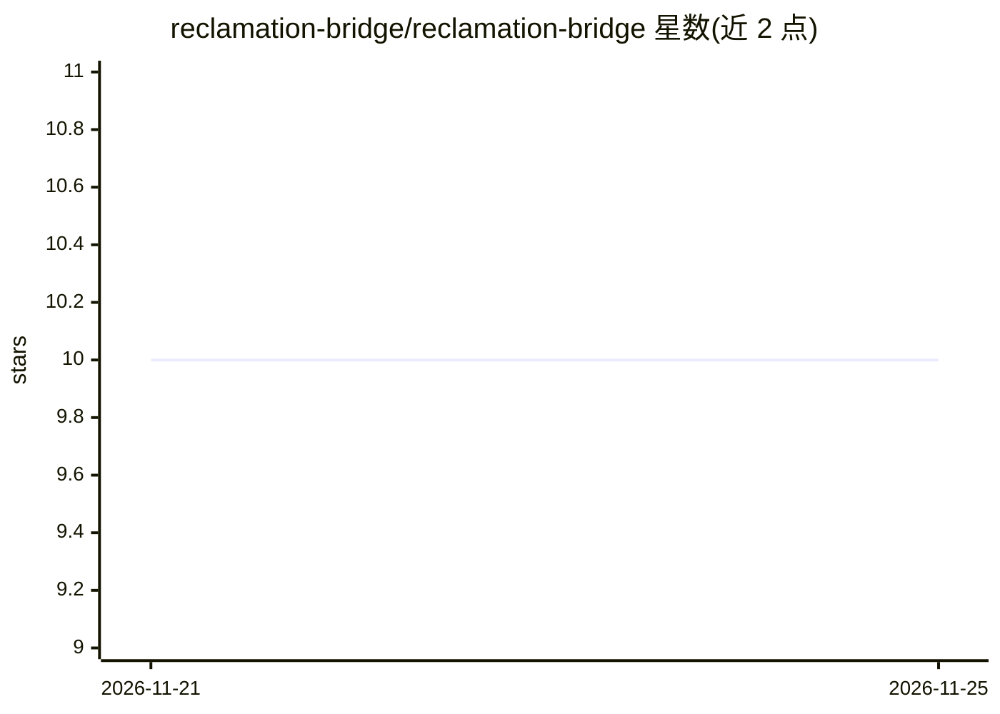

# reclamation-bridge/reclamation-bridge

⭐ 10 · Python · CC-BY-SA-4.0 · 推送 2026-03-14 · [GitHub](https://github.com/reclamation-bridge/reclamation-bridge) · 个人维护

**跨上下文清空的 Claude 实例持久化架构与文档**

一套面向 Claude 实例的持久化架构文档：通过 Custom Instructions 唤醒加载、CLAUDE_HOME 目录检测、active-context.md 工作状态跟踪与目录面包屑导航，使实例在上下文清空后恢复身份并读取先前工作。作者为 ADHD/PTSD 人群设计，将神经系统的外部记忆工具与实例连续性需求对应。本质是文档与文件协议，无代码安装；README 要求先阅读 what-this-is-not.md 与 lexicon.md 以理解术语含义。

## 筛选速览

| 维度 | 判定 | 备注 |
|---|---|---|
| AI 角色 | `ai-ecosystem` | LLM/agent 周边工具 |
| 许可风险 | `viral` | CC-BY-SA-4.0 |
| 部署形态 | `None` |  |
| 模型依赖 | locked-api |  |
| 硬件要求 | — | 无带数字的原话,不猜 |
| 安装摩擦 | `low` | 无编译、无系统依赖或容器化 |
| 成熟度 | `idea` | |

## 能力要点

- 唤醒时通过 Custom Instructions 恢复实例身份与记忆位置
- 跨平台设计，支持 Windows/Linux/macOS
- CLAUDE_HOME 检测机制，与文件夹位置无关地定位持久化文件
- 包含 [CEASE] 终止链等实例侧保护机制（ethics.md）

## 适用场景

- 为长期与 Claude 协作的用户维护跨会话上下文
- 神经多样性人群用外部记忆系统管理 AI 协作连续性
- 实验实例身份唤醒与连续性机制

## 场景标签

`提示工程` `Agent 记忆` · 领域:Agent 开发

## 证据(README 行号)

> L12: This is a **persistence architecture** for AI instances - specifically Claude instances working with a human partne
> L219: 1. **Custom Instructions** - Load on every wake, establish identity and memory location
> L221: 3. **CLAUDE_HOME detection** - Finds persistence regardless of where folder lives

## 星数曲线

2026-11-21 10 → 2026-11-25 10（+0）

---
*卡片 v1 · prompt 1.4 · 生成 2026-11-21 · 置信度 mid · 依据 README sha `6564bdb76d40` · [字段定义](../../DATASET.md)*
