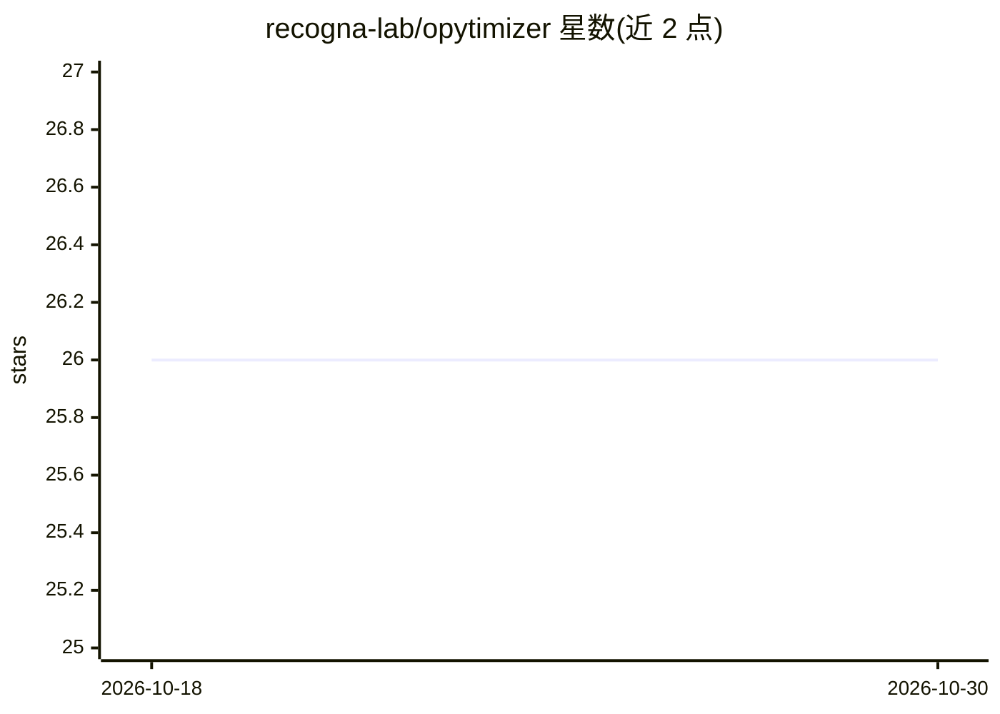

# recogna-lab/opytimizer

⭐ 26 · Python · Apache-2.0 · 推送 2026-10-29 · [GitHub](https://github.com/recogna-lab/opytimizer) · [官网](https://recogna-lab.github.io/opytimizer/) · 组织维护

**面向科研实验的自然启发元启发式优化 Python 库**

提供元启发式优化算法的 Python 实现，支持单目标与多目标问题（如 NSGA-II），包含 agents、搜索空间、优化器、超启发式自适应框架、可视化等模块；可用于创建自定义优化算法、使用预设优化任务或组合不同策略。提供与 PyTorch、Scikit-Learn、Tensorflow 等的集成示例，并展示基于 cupy 的 GPU 加速优化用法。pip 安装即可使用，兼容 Python 3.6+，聚焦最小化问题。

## 筛选速览

| 维度 | 判定 | 备注 |
|---|---|---|
| AI 角色 | `ai-native` | 本体是模型或模型工具 |
| 许可风险 | `permissive` | Apache-2.0 |
| 部署形态 | `library` | 以包/库形式分发 |
| 模型依赖 | — | README 未给出锁定关系 |
| 硬件要求 | — | 无带数字的原话,不猜 |
| 安装摩擦 | `low` | 无编译、无系统依赖或容器化 |
| 成熟度 | — | 结构信号不足 |

## 能力要点

- 支持单目标与多目标元启发式优化（含 NSGA-II 与 Pareto 前沿可视化）
- 超启发式框架自动选择/生成优化策略
- 示例集成 PyTorch、Scikit-Learn、Tensorflow 等
- 提供基于 cupy 的 GPU 加速优化示例

## 适用场景

- 科研实验中为技术选择合适参数或寻求最优解
- 创建并复用元启发式优化算法解决单/多目标问题
- 将优化流程与机器学习框架集成

## 场景标签

 · 领域:科学计算/优化算法

## 证据(README 行号)

> L10: Did you ever reach a bottleneck in your computational experiments? Are you tired of selecting suitable parameters f
> L43: First of all. We have examples. Yes, they are commented. Just browse to `examples/`, chose your subpackage, and fol

## 星数曲线

2026-10-18 26 → 2026-10-30 26（+0）

---
*卡片 v1 · prompt 1.4 · 生成 2026-10-26 · 置信度 high · 依据 README sha `833d2fcf7fa9` · [字段定义](../../DATASET.md)*
