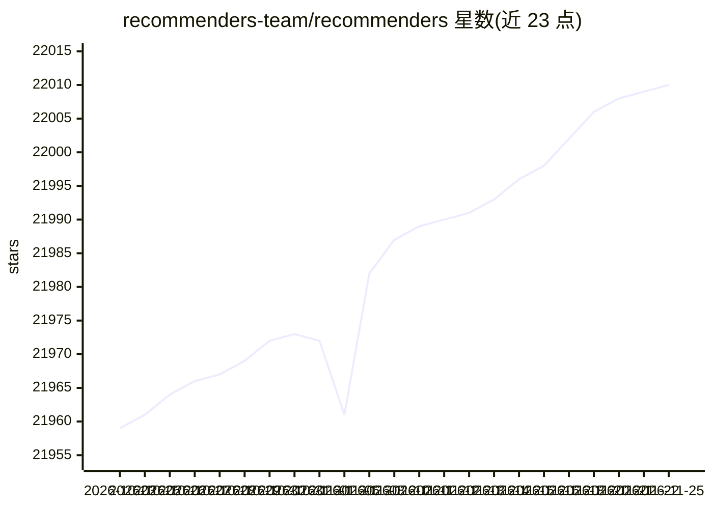

# recommenders-team/recommenders

⭐ 22,010 · Python · MIT · 推送 2026-11-05 · [GitHub](https://github.com/recommenders-team/recommenders) · [官网](https://recommenders-team.github.io/recommenders/intro.html) · 组织维护

**为研究人员与开发者提供推荐系统算法实现与最佳实践库**

Linux Foundation of AI and Data 旗下的推荐系统项目，以 Jupyter notebook 形式提供从数据准备、模型构建、离线评估、超参调优到 Azure 上生产化部署五类任务的示例与最佳实践；随包提供数据加载、评估、训练/测试切分等工具函数，并内置多种经典与深度学习推荐算法实现供学习与定制。通过 PyPI 安装，提供 gpu/spark/dev 等可选扩展，另附算法基准对比 notebook。

## 筛选速览

| 维度 | 判定 | 备注 |
|---|---|---|
| AI 角色 | `ai-native` | 本体是模型或模型工具 |
| 许可风险 | `permissive` | MIT |
| 部署形态 | `library` | 以包/库形式分发 |
| 模型依赖 | — | README 未给出锁定关系 |
| 硬件要求 | — | 无带数字的原话,不猜 |
| 安装摩擦 | `medium` | 含编译或系统依赖之一 |
| 成熟度 | — | 结构信号不足 |

## 动量与使用信号

- 维护:`active` — 距上次 push 0.9 天,年发版 0,116 位贡献者
- 涨星:近 1 天 **+1**(自 20261016 起算)
- 安装:pypi 包 `recommenders` 月下载 7,685
- 平台:WINDOWS / MACOS / LINUX · 协议:—

## 能力要点

- 以 Jupyter notebook 提供 Quick start 与 Deep dive 两级示例
- 内置 ALS、xDeepFM、SASRec、LightGCN 等 30 余种协同过滤与内容过滤算法
- 提供 [gpu]/[spark]/[dev]/[all]/[experimental] 可选安装扩展
- 提供基于 MovieLens 数据集的算法对比基准 notebook

## 适用场景

- 为业务数据原型化并实验不同的推荐算法
- 用离线指标评估与比较多种推荐模型
- 参考最佳实践将推荐模型部署到 Azure 生产环境

## 场景标签

`推荐系统` · 领域:学习与行业

## 证据(README 行号)

> L19: Recommenders objective is to assist researchers, developers and enthusiasts in prototyping, experimenting with and 
> L23: This repository contains examples and best practices for building recommendation systems, provided as Jupyter noteb
> L31: Several utilities are provided in recommenders to support common tasks such as loading datasets in the format expec

## 星数曲线

2026-10-23 21,959 → 2026-11-25 22,010（+51）

---
*卡片 v1 · prompt 1.4 · 生成 2026-11-22 · 置信度 high · 依据 README sha `e16dae799954` · [字段定义](../../DATASET.md)*
