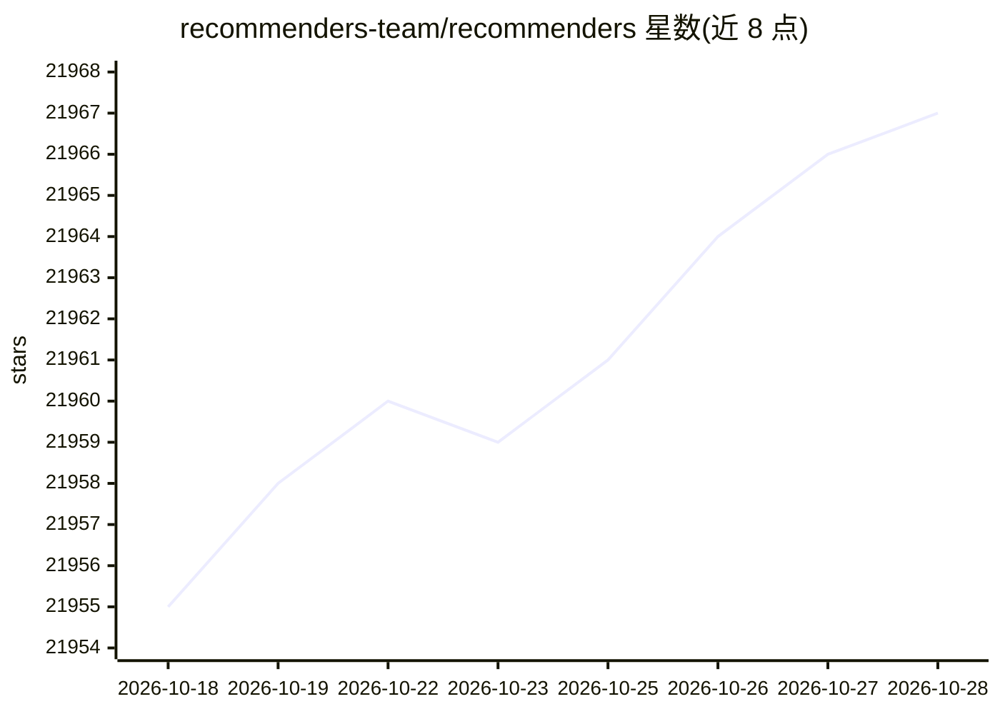

# recommenders-team/recommenders

⭐ 21,969 · Python · MIT · 推送 2026-10-26 · [GitHub](https://github.com/recommenders-team/recommenders) · [官网](https://recommenders-team.github.io/recommenders/intro.html) · 组织维护

**面向研究者与开发者的推荐系统最佳实践库与示例集**

Recommenders 是 Linux Foundation of AI and Data 旗下的推荐系统项目，以 Jupyter notebook 形式提供构建推荐系统的示例与最佳实践，覆盖数据准备、模型构建、离线评估、超参调优与模型在 Azure 上的生产化五类任务，并附带数据加载、评估、训练/测试切分等工具。仓库收录多种经典与深度学习推荐算法实现，提供 uv 管理环境与 PyPI 安装途径，可选 gpu/spark/experimental 等扩展，附算法对比基准 notebook（MovieLens 数据集）。

## 筛选速览

| 维度 | 判定 | 备注 |
|---|---|---|
| AI 角色 | `ai-ecosystem` | LLM/agent 周边工具 |
| 许可风险 | `permissive` | MIT |
| 部署形态 | `library` | 以包/库形式分发 |
| 模型依赖 | — | README 未给出锁定关系 |
| 硬件要求 | — | 无带数字的原话,不猜 |
| 安装摩擦 | `medium` | 含编译或系统依赖之一 |
| 成熟度 | — | 结构信号不足 |

## 动量与使用信号

- 维护:`active` — 距上次 push 0.9 天,年发版 0,116 位贡献者
- 涨星:近 1 天 **+1**(自 20261016 起算)
- 安装:pypi 包 `recommenders` 月下载 7,685
- 平台:WINDOWS / MACOS / LINUX · 协议:—

## 能力要点

- 以 Jupyter notebook 提供 Quick start 与 Deep dive 两级示例
- 收录 ALS、xDeepFM、LightGCN、SASRec 等多类推荐算法实现
- 提供 gpu、spark、dev、all、experimental 等安装扩展选项
- 提供基于 MovieLens 的算法对比基准 notebook

## 适用场景

- 为推荐算法原型实验查找可运行的示例代码
- 按数据准备、建模、评估、调优、上线流程学习推荐系统
- 对比不同协同过滤算法在 MovieLens 上的指标表现
- 将推荐模型部署到 Azure 生产环境

## 场景标签

`推荐系统` `教程课程` · 领域:学习与行业

## 证据(README 行号)

> L19: Recommenders objective is to assist researchers, developers and enthusiasts in prototyping, experimenting with and 
> L23: This repository contains examples and best practices for building recommendation systems, provided as Jupyter noteb
> L21: Recommenders is a project under the Linux Foundation of AI and Data.

## 星数曲线

2026-10-18 21,955 → 2026-10-28 21,967（+12）

---
*卡片 v1 · prompt 1.4 · 生成 2026-10-18 · 置信度 high · 依据 README sha `8b406a8b4479` · [字段定义](../../DATASET.md)*
