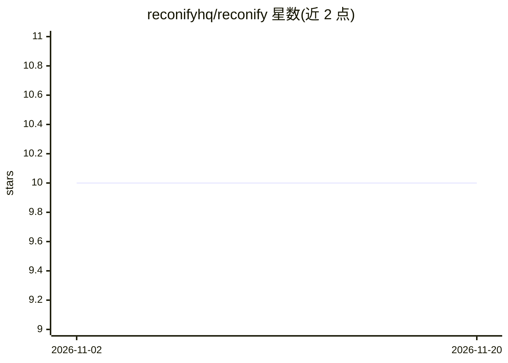

# reconifyhq/reconify

⭐ 10 · Go · MIT · 推送 2026-10-08 · [GitHub](https://github.com/reconifyhq/reconify) · [官网](https://docs.reconifyhq.com/cli) · 组织维护

**给财务/开发者的对账 CLI：规则匹配交易并输出证据**

Go 编写的对账 CLI 与库：读取银行、支付服务商、账本与电子表格文件，规范化为统一交易格式后按显式规则匹配，报告精确匹配、单侧缺失、金额/时间差异、重复组及一对多/多对多分组结算等异常。支持 CSV/JSON/NDJSON/XLSX 输入、四种索引后端控制大文件内存、多种输出格式与稳定退出码供 CI 使用；另提供 npx 安装的 agent skills 包（Claude/Codex 适配器），核心引擎为确定性规则匹配。

## 筛选速览

| 维度 | 判定 | 备注 |
|---|---|---|
| AI 角色 | `ai-enhanced` | 去掉 AI 部分产品仍成立 |
| 许可风险 | `permissive` | MIT |
| 部署形态 | `desktop` | 安装包/桌面程序 |
| 模型依赖 | — | README 未给出锁定关系 |
| 硬件要求 | — | 无带数字的原话,不猜 |
| 安装摩擦 | `low` | 无编译、无系统依赖或容器化 |
| 成熟度 | — | 结构信号不足 |

## 能力要点

- 规则化匹配分类：match/amount_diff/timing_diff/unmatched
- 一对多、多对多、subset_sum 等可选匹配 pass
- memory/disk/auto/partitioned 四种索引后端与资源预算
- 机器Readable契约：--agent、结构化诊断、稳定退出码、schema 命令

## 适用场景

- 核对内部账本与 PSP 结算文件之间的差异
- CI 中定时对账并按异常退出码告警
- 在编码 agent 中通过 skills 包驱动对账工作流
- 大文件对账时限制内存与临时磁盘用量

## 场景标签

 · 领域:金融科技/对账

## 证据(README 行号)

> L5: Reconify is an open-source Go CLI and library for reconciling financial records from banks, payment service provider
> L91:  Install the agent skills
> L93: If you are driving Reconify from a coding agent, install the guided workflows too:

## 星数曲线

2026-11-02 10 → 2026-11-20 10（+0）

---
*卡片 v1 · prompt 1.4 · 生成 2026-11-19 · 置信度 high · 依据 README sha `06ef07f09420` · [字段定义](../../DATASET.md)*
