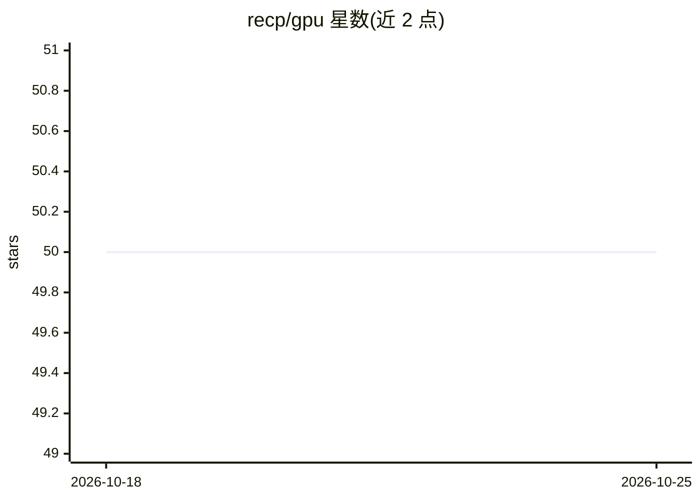

# recp/gpu

⭐ 50 · C · Apache-2.0 · 推送 2026-10-20 · [GitHub](https://github.com/recp/gpu) · [官网](http://recp.me/gpu/) · 个人维护

**跨平台 C 语言 GPU 图形与计算库（Metal/Vulkan/DX12/WebGPU）**

受 Metal API 启发的跨平台 C 库，提供显式图形渲染与 GPU 计算抽象，后端覆盖 Metal、Vulkan、DirectX 12 与 WebGPU。通过集成 Universal Shading（USL）完成着色器解析、反射与目标编译，同一 USL 源可在多后端生成原生着色器。以 CMake 源码构建方式提供，附三角形、纹理、计算到渲染等示例；README 声明项目处于活跃开发期，公开 API 尚未稳定。

## 筛选速览

| 维度 | 判定 | 备注 |
|---|---|---|
| AI 角色 | `ai-enhanced` | 去掉 AI 部分产品仍成立 |
| 许可风险 | `permissive` | Apache-2.0 |
| 部署形态 | `None` |  |
| 模型依赖 | — | README 未给出锁定关系 |
| 硬件要求 | — | 无带数字的原话,不猜 |
| 安装摩擦 | `medium` | 含编译或系统依赖之一 |
| 成熟度 | `idea` | |

## 能力要点

- 四个后端：Metal、Vulkan、DirectX 12、WebGPU
- 集成 USL 完成着色器解析/反射/编译与产物缓存，一份源码多后端复用
- 帧-命令缓冲-显式渲染通道的通用渲染路径，支持手动 submit 控制
- 附 WebGPU 在线示例与多后端示例工程

## 适用场景

- 用统一 C API 跨 Metal/Vulkan/DX12/WebGPU 编写渲染与计算程序
- 同一 USL 着色器源在桌面与浏览器后端间复用
- 为图形或 GPU 通用计算项目搭建跨平台后端抽象

## 场景标签

 · 领域:图形/GPU 计算

## 证据(README 行号)

> L3: GPU is a cross-platform C library for explicit graphics and compute workloads.
> L7: !! The project is under active development. The public API may not yet stable.

## 星数曲线

2026-10-18 50 → 2026-10-25 50（+0）

---
*卡片 v1 · prompt 1.4 · 生成 2026-10-24 · 置信度 mid · 依据 README sha `8d4ae38ed1dc` · [字段定义](../../DATASET.md)*
