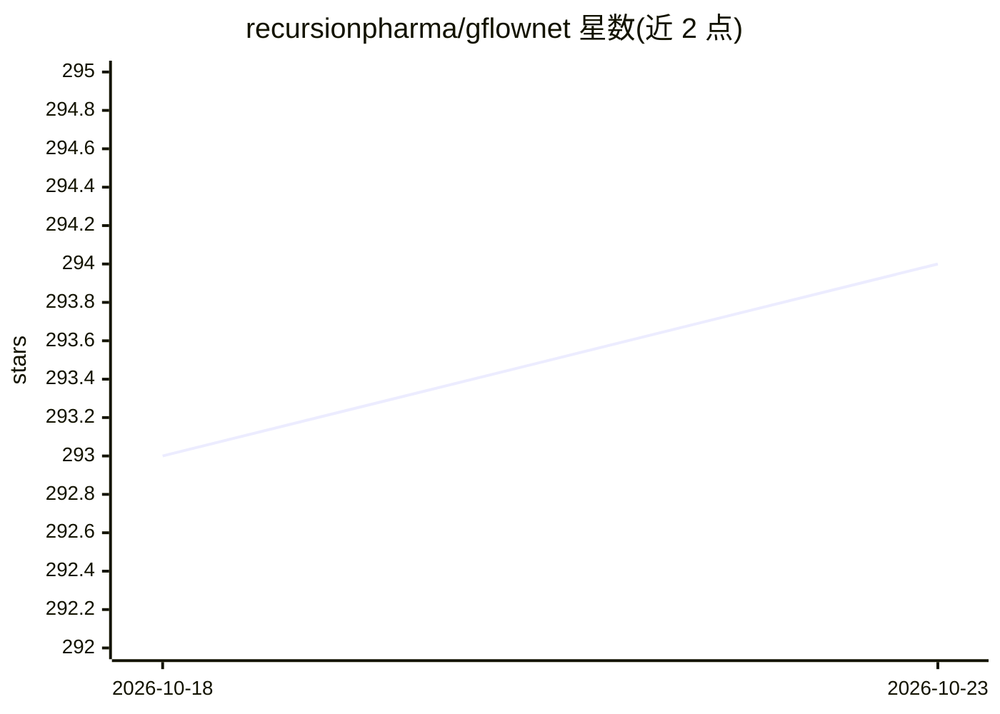

# recursionpharma/gflownet

⭐ 294 · Python · MIT · 推送 2026-09-15 · [GitHub](https://github.com/recursionpharma/gflownet) · 组织维护

**面向图与分子数据的 GFlowNet 训练与环境库**

Recursion 维护的 GFlowNet（Generative Flow Network）库，专注于图（如原子图、分子）的生成建模：以图神经网络输出逐节点与全图 logits，按轨迹顺序构图，支持 Trajectory Balance、SubTB、Flow Matching 等算法及部分基线，可混合离线数据与在线自生成轨迹训练。内置 QM9 分子采样、sEH 片段分子设计及多目标优化等任务，以 pip 包安装，需指定 torch-geometric wheel 链接。

## 筛选速览

| 维度 | 判定 | 备注 |
|---|---|---|
| AI 角色 | `ai-native` | 本体是模型或模型工具 |
| 许可风险 | `permissive` | MIT |
| 部署形态 | `library` | 以包/库形式分发 |
| 模型依赖 | — | README 未给出锁定关系 |
| 硬件要求 | — | 无带数字的原话,不猜 |
| 安装摩擦 | `medium` | 含编译或系统依赖之一 |
| 成熟度 | — | 结构信号不足 |

## 能力要点

- 实现 Trajectory Balance / SubTB / Flow Matching 等 GFN 算法及基线
- 基于 GNN 的逐节点构图策略，支持离线+在线混合训练
- 内置 QM9、sEH 片段分子设计与多目标优化任务
- 提供通用训练 harness（trainer.py / online_trainer.py）

## 适用场景

- 用 GFlowNet 做分子或图结构生成研究
- 复现 Bengio et al. 2021 sEH 分子设计实验
- 在自己的图环境上训练 GFN 采样模型

## 场景标签

`模型训练` · 领域:训练与推理

## 证据(README 行号)

> L12: GFlowNet [[1]](https://yoshuabengio.org/2022/03/05/generative-flow-networks/), [[2]](https://www.gflownet.org/), [[
> L18: This library supports a variety of GFN algorithms (as well as some baselines), and supports training on a mix of ex

## 星数曲线

2026-10-18 293 → 2026-10-23 294（+1）

---
*卡片 v1 · prompt 1.4 · 生成 2026-10-22 · 置信度 high · 依据 README sha `d9b9a5dc15b0` · [字段定义](../../DATASET.md)*
