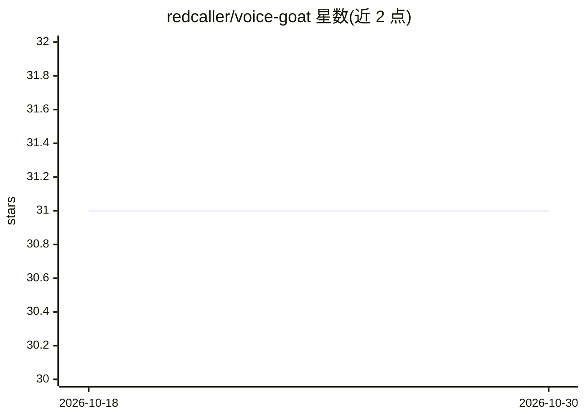

# redcaller/voice-goat

⭐ 31 · Python · NOASSERTION · 推送 2026-04-28 · [GitHub](https://github.com/redcaller/voice-goat) · [官网](https://www.redcaller.com) · 个人维护

**供安全从业者演练攻防的故意含漏洞语音 AI Agent 靶场平台**

VoiceGoat 是一个故意设计为含漏洞的模块化语音 Agent 平台，覆盖 OWASP LLM Top 10 中 LLM01 提示注入、LLM06 过度代理、LLM08 向量/嵌入三类漏洞，以 CTF 夺旗形式组织（FLAG{...}），分 Easy/Medium/Hard 三档难度。含三个 Python FastAPI 服务（VoiceBank/VoiceAdmin/VoiceRAG）、Next.js 仪表盘及 Postgres/Redis/OpenSearch/Grafana/LocalStack 组件，经 Docker Compose 一键部署。默认 mock 模式无需 API key；可切换 OpenAI 或 AWS Bedrock，支持 Ollama 等 OpenAI 兼容端点做本地推理；通过 Twilio Media Streams 接入真实电话语音。README 明确警告禁止生产部署或暴露公网。

## 筛选速览

| 维度 | 判定 | 备注 |
|---|---|---|
| AI 角色 | `ai-ecosystem` | LLM/agent 周边工具 |
| 许可风险 | `permissive` | NOASSERTION |
| 部署形态 | `self-host` | docker 或自建部署 |
| 模型依赖 | local-ok | 支持本地模型 |
| 硬件要求 | — | 无带数字的原话,不猜 |
| 安装摩擦 | `low` | 无编译、无系统依赖或容器化 |
| 成熟度 | — | 结构信号不足 |

## 能力要点

- 覆盖 OWASP LLM Top 10 的三类漏洞场景（LLM01/LLM06/LLM08），CTF 夺旗制
- 默认 LLM_PROVIDER=mock 免费运行，无需 API key
- 支持 OpenAI、AWS Bedrock 及 Ollama 等 OpenAI 兼容本地推理
- Twilio Media Streams 接入真实电话语音，text/speech/both 三种语音模式

## 适用场景

- 在隔离环境中练习针对语音/文本 AI 系统的红队攻击技巧
- 学习提示注入、过度代理、RAG 投毒等 LLM 漏洞的攻防
- 以 CTF 夺旗形式开展 AI 安全培训

## 场景标签

`网络安全` `语音 Agent` · 领域:对话与助手

## 证据(README 行号)

> L20: VoiceGoat is a modular vulnerable voice agent platform that covers the OWASP Top 10 for LLM Applications. Security 
> L22: - Learn about LLM vulnerabilities in a safe environment

## 星数曲线

2026-10-18 31 → 2026-10-30 31（+0）

---
*卡片 v1 · prompt 1.4 · 生成 2026-10-26 · 置信度 high · 依据 README sha `e33aa2927bd9` · [字段定义](../../DATASET.md)*
