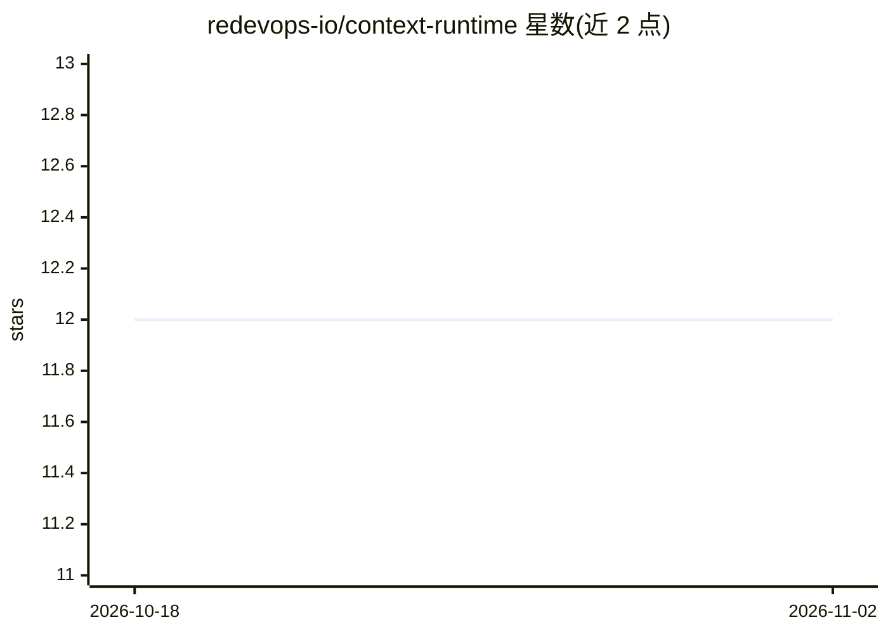

# redevops-io/context-runtime

⭐ 12 · Python · AGPL-3.0 · 推送 2026-11-01 · [GitHub](https://github.com/redevops-io/context-runtime) · 组织维护

**面向 LLM 的上下文查询规划器：按预算决定模型看到什么**

Python 参考实现（alpha）：应用给出目标与预算，运行时规划模型应检索、压缩、路由与校验哪些上下文，生成可检视可重放的计划（explain/simulate），并从结果学习策略（bandit/调参）。面向需在上下文、配置、模型档位间做重复选择且有可度量结果的应用。默认离线 stub 模型运行，真实绑定通过 LiteLLM、redevops-rag、DuckDB/Postgres、HippoRAG、RAGAS 等可选接入。所有奖励数字来自种子化模拟器，未声称生产部署；不在 PyPI，从克隆安装。

## 筛选速览

| 维度 | 判定 | 备注 |
|---|---|---|
| AI 角色 | `ai-ecosystem` | LLM/agent 周边工具 |
| 许可风险 | `viral` | AGPL-3.0 |
| 部署形态 | `library` | 以包/库形式分发 |
| 模型依赖 | — | README 未给出锁定关系 |
| 硬件要求 | — | 无带数字的原话,不猜 |
| 安装摩擦 | `low` | 无编译、无系统依赖或容器化 |
| 成熟度 | `idea` | |

## 能力要点

- 目标+预算驱动的上下文规划，输出可检视可重放的计划（explain/simulate）
- 离线 stub 模型路径，无需 provider key 即可运行；真实绑定 lazy-import
- 插件缝架构：模型/检索/压缩/校验/可观测均可替换（LiteLLM、redevops-rag、HippoRAG、RAGAS、Langfuse 等）
- 13 个离线示例租户展示学习策略对比固定基线（模拟数据）

## 适用场景

- 为 RAG 应用按查询自动选择检索参数（pool/limit/rerank）
- 在多个模型档位与工具选择间做成本感知的自动决策
- 需要可解释上下文决策与审计轨迹的 agent 应用

## 场景标签

`LLM 可观测性` · 领域:评测与运维

## 证据(README 行号)

> L7: **What it does.** A "query planner for LLM context": the application states a goal and a budget; the runtime
> L9: plan (`explain`, `simulate`), and learns from the outcome. It is the *Context* part of ReDevOps Runtime: context
> L99: Plus the **ToolPlugin** seam (`context_runtime/tools/` — how plans reach external systems,

## 星数曲线

2026-10-18 12 → 2026-11-02 12（+0）

---
*卡片 v1 · prompt 1.4 · 生成 2026-11-01 · 置信度 mid · 依据 README sha `08f5d25f84a3` · [字段定义](../../DATASET.md)*
