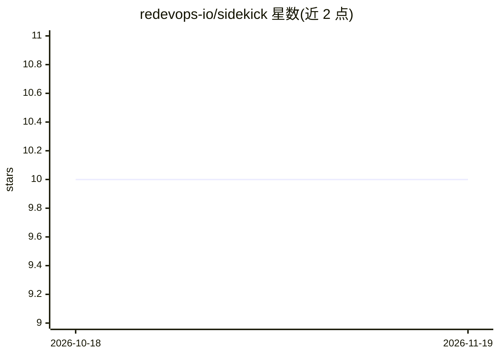

# redevops-io/sidekick

⭐ — · [GitHub]() · 组织维护

**本地编码代理编排器：将任务拆为并行 git worktree 隔离子会话**

sidekick 是本地运行的编码代理编排器：接收高层任务后将其分解为子任务 DAG，为每个子任务启动自动批准、无头的编码代理子会话，各自运行在独立的 git worktree/分支上，通过验收检查后合并分支。代理执行后端可选：经 LiteLLM 路由到任意 LLM 提供商，或驱动原生 Claude Code 二进制；默认 local-cpu 指向本地 OpenAI 兼容服务器，完全离线、无需 API key。提供 rich 终端表格与实况 progress.md、指标报告、sidekick bench 基准命令。README 自述处于 alpha（0.1.0），许可证为 AGPL-3.0 + Commons Clause。

## 筛选速览

| 维度 | 判定 | 备注 |
|---|---|---|
| AI 角色 | `ai-ecosystem` | LLM/agent 周边工具 |
| 许可风险 | `viral` | — |
| 部署形态 | `library` | 以包/库形式分发 |
| 模型依赖 | local-ok | 支持本地模型 |
| 硬件要求 | — | 无带数字的原话,不猜 |
| 安装摩擦 | `medium` | 含编译或系统依赖之一 |
| 成熟度 | `idea` | |

## 能力要点

- 任务分解为 DAG，每个子任务在独立 git worktree 上运行自动批准的子会话
- 单一代码库经 LiteLLM 接入多提供商，或驱动原生 Claude Code 二进制
- 默认 local-cpu 提供商完全离线、无需 API key
- 实况 progress.md 面板与可量化 speed/accuracy 目标报告

## 适用场景

- 在一个仓库上并行运行多个编码代理
- 离线环境下用本地模型编排编码子任务
- 在 VSCode 集成终端里把并行代理执行纳入日常编码流程

## 场景标签

`编码 Agent` · 领域:编码与开发

## 证据(README 行号)

> L7: - **What it does:** local coding-agent orchestrator that fans a task out into auto-approved sub-sessions on isolated
> L17: 2. fans out one **auto-approved, headless coding agent per subtask** — **any LLM via
> L89: backend**. Pick a provider with `--provider` (or `SIDEKICK_PROVIDER`); everything except

## 星数曲线

2026-10-18 10 → 2026-11-19 10（+0）

---
*卡片 v1 · prompt 1.4 · 生成 2026-11-19 · 置信度 high · 依据 README sha `68c5ffbc0095` · [字段定义](../../DATASET.md)*
