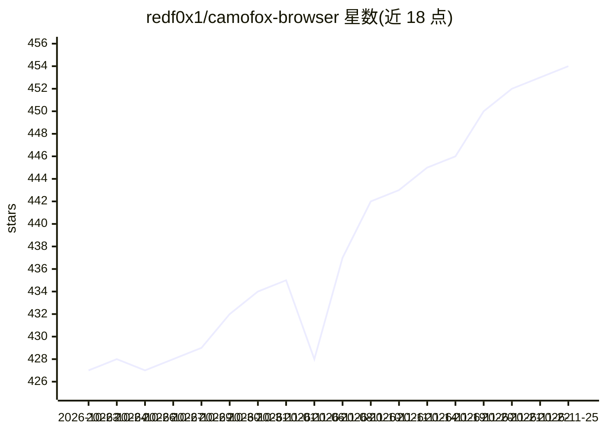

# redf0x1/camofox-browser

⭐ 454 · JavaScript · MIT · 推送 2026-11-06 · [GitHub](https://github.com/redf0x1/camofox-browser) · 个人维护

**给 AI agent 提供反检测浏览器自动化的 REST 服务器**

TypeScript 编写的 REST API 服务器，封装 Camoufox（Firefox 分支）浏览器引擎，在 C++ 引擎层做指纹伪装而非 JS 注入。面向 AI agent 与自动化场景提供多会话隔离、持久浏览器配置、地区预设、14 个搜索宏、无障碍快照元素引用、Cookie 导入导出、AES-256-GCM 凭据保险库及 50+ 命令的 CLI。要求 Node.js 22+（Linux 解压依赖 Python 3），当前处于 Preview 阶段，不保证 API 冻结与本地状态自动迁移。

## 筛选速览

| 维度 | 判定 | 备注 |
|---|---|---|
| AI 角色 | `ai-enhanced` | 去掉 AI 部分产品仍成立 |
| 许可风险 | `permissive` | MIT |
| 部署形态 | `self-host` | docker 或自建部署 |
| 模型依赖 | — | README 未给出锁定关系 |
| 硬件要求 | — | 无带数字的原话,不猜 |
| 安装摩擦 | `low` | 无编译、无系统依赖或容器化 |
| 成熟度 | `idea` | |

## 能力要点

- 封装 Camoufox 引擎，C++ 层级指纹伪装，无 JS 注入
- REST API 与 CLI 双入口，50+ 终端命令
- 按 userId 的多会话隔离与持久浏览器配置（Cookie/localStorage/IndexedDB）
- AES-256-GCM 凭据保险库，--inject 不向 agent 暴露密码

## 适用场景

- 让 AI agent 通过 REST 端点操控反检测浏览器抓取页面
- 多账号场景下维持独立的浏览器指纹与 Cookie 状态
- 在终端用 CLI 完成打开页面、快照、点击、截图等自动化流程

## 场景标签

`浏览器自动化` `网页抓取` · 领域:效率与自动化

## 证据(README 行号)

> L3: > Anti-detection browser server for AI agents — TypeScript REST API wrapping the Camoufox stealth browser engine
> L29: - **REST API** — language-agnostic HTTP endpoints for browser automation and AI agent integration

## 星数曲线

2026-10-23 427 → 2026-11-25 454（+27）

---
*卡片 v1 · prompt 1.4 · 生成 2026-11-25 · 置信度 high · 依据 README sha `8c5b1090d7d3` · [字段定义](../../DATASET.md)*
