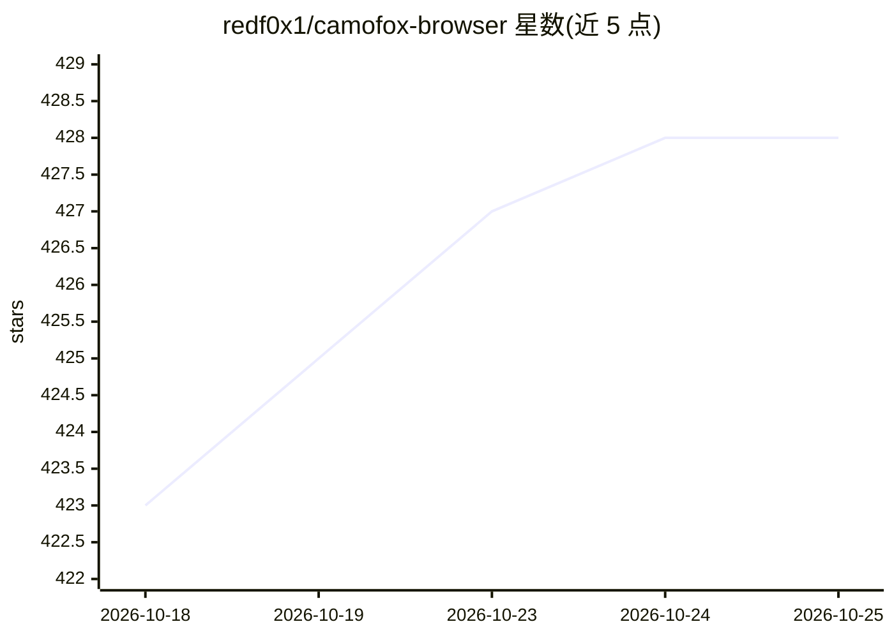

# redf0x1/camofox-browser

⭐ 428 · JavaScript · MIT · 推送 2026-09-22 · [GitHub](https://github.com/redf0x1/camofox-browser) · 个人维护

**面向 AI agent 的反检测浏览器服务器（封装 Camoufox 引擎）**

基于 TypeScript/Express 的 REST API 服务器，封装 Camoufox（Firefox 分支，C++ 引擎级指纹伪装）供 AI agent 与任意语言调用。提供多会话隔离上下文（默认 50 会话/10 标签页）、持久化浏览器配置档、会话级代理/地理覆盖、14 个搜索宏、带元素引用的无障碍快照、结构化 JSON 抽取、CLI（50+ 命令）、AES-256-GCM 认证保险库与 Playwright 追踪。支持 OpenClaw 插件端点与 MCP 外部集成。项目自声明处于 Preview 阶段，API 面可能变化，本地状态不保证自动迁移。

## 筛选速览

| 维度 | 判定 | 备注 |
|---|---|---|
| AI 角色 | `ai-ecosystem` | LLM/agent 周边工具 |
| 许可风险 | `permissive` | MIT |
| 部署形态 | `self-host` | docker 或自建部署 |
| 模型依赖 | — | README 未给出锁定关系 |
| 硬件要求 | — | 无带数字的原话,不猜 |
| 安装摩擦 | `low` | 无编译、无系统依赖或容器化 |
| 成熟度 | `idea` | |

## 能力要点

- C++ 引擎级指纹伪装（非 JavaScript 注入）
- REST API + OpenClaw 端点，多会话隔离与持久化配置档
- 14 个搜索宏与带 eN 元素引用的无障碍快照（token 效率）
- CLI 50+ 命令、认证保险库（凭据不进 stdout）、管道脚本

## 适用场景

- 让 AI agent 在反检测浏览器中执行自动化任务
- 需要多用户隔离会话与持久登录状态的浏览器服务
- 通过 CLI 或 REST API 做结构化网页数据抽取

## 场景标签

`浏览器自动化` `网页抓取` · 领域:效率与自动化

## 证据(README 行号)

> L3: > Anti-detection browser server for AI agents — TypeScript REST API wrapping the Camoufox stealth browser engine
> L29: - **REST API** — language-agnostic HTTP endpoints for browser automation and AI agent integration
> L37: - **OpenClaw Plugin** — OpenClaw-compatible endpoints (`/start`, `/tabs/open`, `/act`, etc.)

## 星数曲线

2026-10-18 423 → 2026-10-25 428（+5）

---
*卡片 v1 · prompt 1.4 · 生成 2026-10-21 · 置信度 high · 依据 README sha `372ad3e84a75` · [字段定义](../../DATASET.md)*
