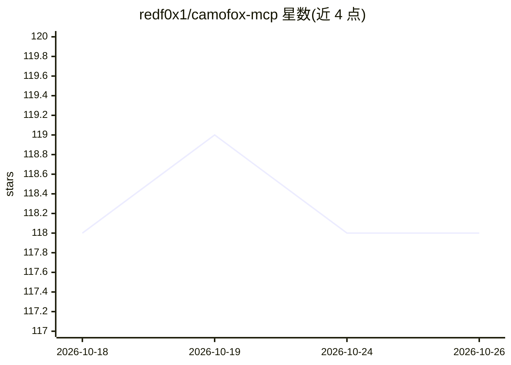

# redf0x1/camofox-mcp

⭐ 118 · TypeScript · MIT · 推送 2026-10-25 · [GitHub](https://github.com/redf0x1/camofox-mcp) · 个人维护

**为 MCP AI 代理提供反检测浏览器自动化工具的服务端**

CamoFox MCP 将 Claude Desktop、VS Code、Cursor、OpenClaw 等 MCP 客户端连接到独立的 camofox-browser 浏览器服务端，提供 47 个浏览器自动化工具，覆盖导航、交互、观察、搜索、下载、会话与批量工作流，底层基于 Camoufox 反检测行为。支持 stdio（npx）与 HTTP 传输（Docker），支持多标签页状态跟踪、Cookie 导入与保存配置。限制：本产品非独立浏览器，需单独运行 camofox-browser 服务端；Windows x64 仅支持 headless 便携发行版。MIT 许可。

## 筛选速览

| 维度 | 判定 | 备注 |
|---|---|---|
| AI 角色 | `ai-ecosystem` | LLM/agent 周边工具 |
| 许可风险 | `permissive` | MIT |
| 部署形态 | `self-host` | docker 或自建部署 |
| 模型依赖 | — | README 未给出锁定关系 |
| 硬件要求 | — | 无带数字的原话,不猜 |
| 安装摩擦 | `low` | 无编译、无系统依赖或容器化 |
| 成熟度 | — | 结构信号不足 |

## 能力要点

- 47 个浏览器自动化工具（导航/交互/观察/搜索/下载/会话/批量）
- 基于 Camoufox 的反检测行为与多标签页状态跟踪
- stdio 与 OpenClaw 兼容 HTTP 两种传输方式
- 会话持久化：Cookie 导入、保存配置、可选自动保存

## 适用场景

- 让 AI 代理以较低被封锁风险浏览和操作网页
- 需要会话与 Cookie 复用的代理网页自动化流程
- 远程 MCP 客户端通过 HTTP 接入浏览器自动化

## 场景标签

`浏览器自动化` · 领域:效率与自动化

## 证据(README 行号)

> L3: AI-powered anti-detection browser automation for MCP-compatible AI agents.
> L5: CamoFox MCP connects MCP clients such as Claude Desktop, VS Code, Cursor, and OpenClaw to the CamoFox browser server

## 星数曲线

2026-10-18 118 → 2026-10-26 118（+0）

---
*卡片 v1 · prompt 1.4 · 生成 2026-10-23 · 置信度 high · 依据 README sha `de9e0c6e0b72` · [字段定义](../../DATASET.md)*
