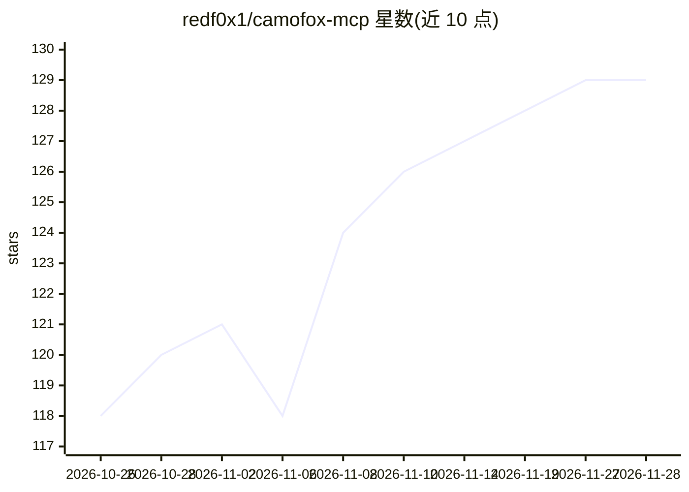

# redf0x1/camofox-mcp

⭐ 129 · TypeScript · MIT · 推送 2026-11-06 · [GitHub](https://github.com/redf0x1/camofox-mcp) · 个人维护

**给 MCP AI agent 提供反检测浏览器自动化工具集**

一个 MCP 服务器，把 MCP 客户端（Claude Desktop、VS Code、Cursor、OpenClaw）连接到 camofox-browser 反检测浏览器服务器，提供 53 个浏览器自动化工具，覆盖导航、交互、观察、搜索、下载、会话持久化、配置档、批量工作流与网络捕获。底层依赖 Camoufox 的反检测能力；本仓库自身不是独立浏览器，需单独运行兼容的 camofox-browser 服务器。支持 npx/stdio 与 Docker/HTTP 两种部署方式，HTTP 传输可用 Bearer API key 保护。MIT 许可。

## 筛选速览

| 维度 | 判定 | 备注 |
|---|---|---|
| AI 角色 | `ai-ecosystem` | LLM/agent 周边工具 |
| 许可风险 | `permissive` | MIT |
| 部署形态 | `self-host` | docker 或自建部署 |
| 模型依赖 | — | README 未给出锁定关系 |
| 硬件要求 | — | 无带数字的原话,不猜 |
| 安装摩擦 | `low` | 无编译、无系统依赖或容器化 |
| 成熟度 | — | 结构信号不足 |

## 能力要点

- 53 个浏览器自动化工具，覆盖 13 个类别
- 会话持久化：cookie 导入、保存配置档、可选自动保存
- 网络捕获与导出 HAR、fetch/XHR 拦截（需浏览器 2.5.0+）
- 自定义搜索引擎模板，支持 SearXNG 实例

## 适用场景

- 让 Claude Desktop 或 Cursor 中的 agent 自动浏览和抓取网页
- 在反检测浏览器中运行多标签页批量工作流
- 远程 MCP 客户端通过 HTTP 接入浏览器工具集

## 场景标签

`浏览器自动化` `网页抓取` `工作流自动化` · 领域:效率与自动化

## 证据(README 行号)

> L3: AI-powered anti-detection browser automation for MCP-compatible AI agents.
> L5: CamoFox MCP connects MCP clients such as Claude Desktop, VS Code, Cursor, and OpenClaw to the CamoFox browser server
> L113: - CamoFox MCP is not a standalone browser. You must run a compatible `camofox-browser` server separately.

## 星数曲线

2026-10-26 118 → 2026-11-28 129（+11）

---
*卡片 v1 · prompt 1.4 · 生成 2026-11-28 · 置信度 high · 依据 README sha `436e79b0c228` · [字段定义](../../DATASET.md)*
