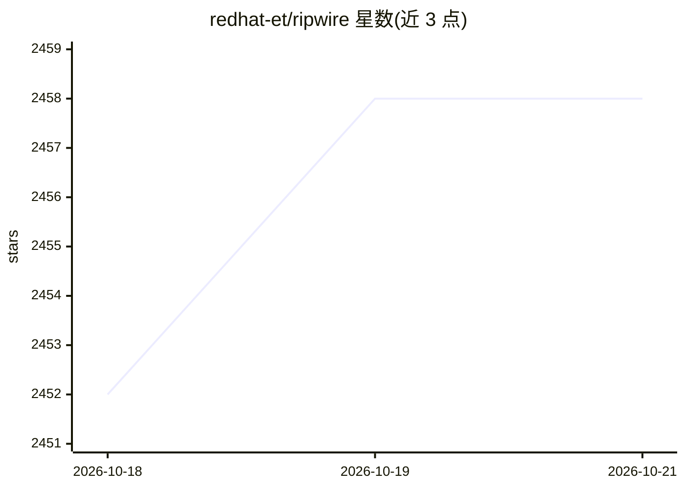

# redhat-et/ripwire

⭐ — · [GitHub]() · 组织维护

**给编码 agent 的代码上下文 CLI + MCP 服务器：调用图导航与编辑检查**

零依赖的 C++23 单二进制工具，为 Claude Code、Codex、Cursor 等 coding agent 提供两套接口：CLI 与可选的 MCP 服务器。核心功能是确定性调用图查询（该改哪里、影响面、需跑哪些测试）、编辑后检查（blast radius、契约校验）、十二类质量增量报告，以及固定在符号上的持久笔记。签名提取以更少字节替代函数体供 agent 消费；无 API key、无索引服务器、无守护进程，离线运行。一行安装脚本同时为机器上发现的各 agent 装配技能。限制：contract checker 的 arity 启发式在带默认参数场景会误报，文档建议此时以编译验证。

## 筛选速览

| 维度 | 判定 | 备注 |
|---|---|---|
| AI 角色 | `ai-ecosystem` | LLM/agent 周边工具 |
| 许可风险 | `permissive` | — |
| 部署形态 | `desktop` | 安装包/桌面程序 |
| 模型依赖 | — | README 未给出锁定关系 |
| 硬件要求 | — | 无带数字的原话,不猜 |
| 安装摩擦 | `high` | 编译与系统依赖俱全 |
| 成熟度 | — | 结构信号不足 |

## 能力要点

- 排序的确定性调用图：改动影响面、触及该处的测试、多义名称解析
- --edit-check 契约校验与只报告恶化项的十二类质量增量
- 单进程离线索引（本仓库 0.25 s / 6.6 MB），无 API key、无索引服务器
- 一行安装同时为 Claude Code/Codex/Cursor/Windsurf/Gemini/opencode/aider 激活技能

## 适用场景

- 让编码 agent 在读仓库前先拿调用图定位改动点与影响面
- agent 提交前自动跑质量门与契约检查，拦截静默劣化
- 多 agent 编排中通过符号笔记共享代码库注意事项

## 场景标签

`编码 Agent` · 领域:编码与开发

## 证据(README 行号)

> L14: Ranked, deterministic call graph: what to touch, what it breaks, which tests to run. On the edit: blast
> L149:  One binary, offline — and the same line activates the skills for every agent it finds: Claude Code · Codex · Curs
> L155: set up the moment the install finishes; [the MCP server is the optional second

## 星数曲线

2026-10-18 2,452 → 2026-10-21 2,458（+6）

---
*卡片 v1 · prompt 1.4 · 生成 2026-10-21 · 置信度 mid · 依据 README sha `33a511936c35` · [字段定义](../../DATASET.md)*
