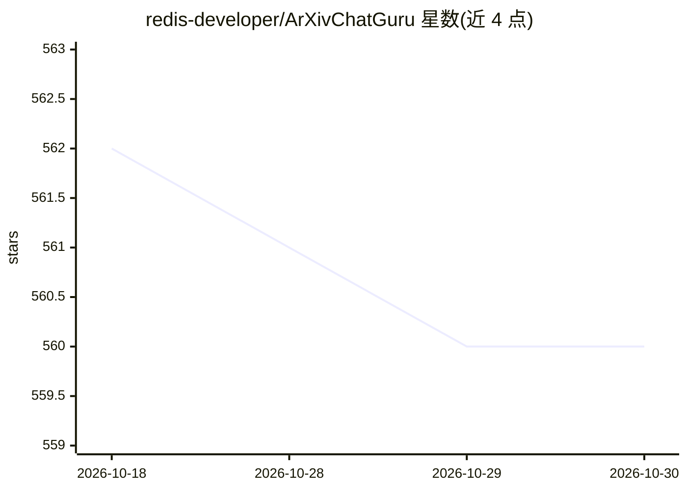

# redis-developer/ArXivChatGuru

⭐ 560 · Python · MIT · 推送 2026-03-18 · [GitHub](https://github.com/redis-developer/ArXivChatGuru) · 组织维护

**面向 arXiv 论文的 RAG 问答演示应用（Streamlit+Redis）**

由 Redis 开发者团队维护的 Streamlit 应用：用户输入主题后从 arXiv 抓取论文、切块、用 OpenAI 生成嵌入，存入按主题划分的 Redis 向量索引，随后可对已加载论文提问，LangChain 检索最相关块交给聊天模型回答。README 自述为学习性质项目，刻意保持简单，用于展示 Redis 在论文问答流程中的角色，并非生产级研究助手。提供 Docker Compose 与 Poetry 本地两种运行方式，需 OpenAI API key；含可查看索引状态的统计页。

## 筛选速览

| 维度 | 判定 | 备注 |
|---|---|---|
| AI 角色 | `ai-native` | 本体是模型或模型工具 |
| 许可风险 | `permissive` | MIT |
| 部署形态 | `self-host` | docker 或自建部署 |
| 模型依赖 | — | README 未给出锁定关系 |
| 硬件要求 | — | 无带数字的原话,不猜 |
| 安装摩擦 | `low` | 无编译、无系统依赖或容器化 |
| 成熟度 | — | 结构信号不足 |

## 能力要点

- 主题→arXiv 抓取→切块→OpenAI 嵌入→Redis 向量索引的完整流程
- 按主题划分的 Redis 向量索引与语义缓存存储
- Streamlit 统计页可查看索引元数据与 Query Engine 状态
- Docker Compose 为主要本地运行方式

## 适用场景

- 对指定主题的 arXiv 论文做有据可依的问答
- 学习 Redis 在学术 RAG 流程中的向量检索与缓存用法
- 作为 RAG 应用搭建的教学示例进行修改和扩展

## 场景标签

`RAG` `科研工具` `教程课程` · 领域:知识与检索

## 证据(README 行号)

> L7: ArXiv ChatGuru is a Streamlit app that turns a topic from arXiv into a topic-scoped Redis vector index. It fetches p
> L23: 5. LangChain retrieves the closest chunks for each user question and sends that context to the chat model.

## 星数曲线

2026-10-18 562 → 2026-10-30 560（-2）

---
*卡片 v1 · prompt 1.4 · 生成 2026-10-21 · 置信度 mid · 依据 README sha `ecce6b5aadd8` · [字段定义](../../DATASET.md)*
