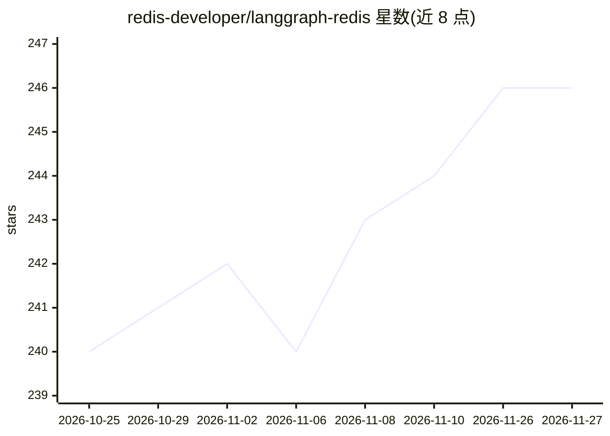

# redis-developer/langgraph-redis

⭐ 246 · Python · MIT · 推送 2026-11-26 · [GitHub](https://github.com/redis-developer/langgraph-redis) · [官网](http://redis-developer.github.io/langgraph-redis/) · 组织维护

**为 LangGraph 提供基于 Redis 的记忆持久化与缓存组件**

redis-developer 维护的 LangGraph 官方 Redis 实现，包含三部分：Checkpoint Saver（同步/异步/浅存储三种，用于保存与管理 agent 状态检查点）、带可选向量搜索的 Redis Store，以及面向 LangChain agent 的中间件（语义缓存、工具结果缓存、会话记忆注入、语义路由）。要求 Redis 8.0+ 或含 RedisJSON/RediSearch 模块的 Redis；首次使用需调用 .setup() 创建索引；支持基于 Redis 原生 EXPIRE 的 TTL 过期与钉住线程。以 pip 包形式提供，示例经 docker compose 运行。

## 筛选速览

| 维度 | 判定 | 备注 |
|---|---|---|
| AI 角色 | `ai-ecosystem` | LLM/agent 周边工具 |
| 许可风险 | `permissive` | MIT |
| 部署形态 | `self-host` | docker 或自建部署 |
| 模型依赖 | — | README 未给出锁定关系 |
| 硬件要求 | — | 无带数字的原话,不猜 |
| 安装摩擦 | `low` | 无编译、无系统依赖或容器化 |
| 成熟度 | — | 结构信号不足 |

## 能力要点

- Redis Checkpoint Saver：同步、异步与仅保留最新检查点的浅存储实现
- Redis Store 支持可选向量索引的相似性搜索
- 四种中间件：语义缓存、工具缓存、会话记忆、语义路由
- 基于 Redis 原生 TTL 的检查点过期与持久化控制

## 适用场景

- 为 LangGraph agent 添加跨线程持久化的长期记忆
- 用语义缓存复用 LLM 响应以降低调用成本
- 为重要会话线程设置持久化、临时数据自动过期

## 场景标签

`Agent 记忆` · 领域:Agent 开发

## 证据(README 行号)

> L15: This repository contains Redis implementations for LangGraph, providing both Checkpoint Savers and Stores functiona
> L23: 3. **Redis Middleware**: LangChain agent middleware for semantic caching, tool caching, and conversation memory
> L190: Redis middleware provides semantic caching, tool result caching, conversation memory, and semantic routing for Lan

## 星数曲线

2026-10-25 240 → 2026-11-27 246（+6）

---
*卡片 v1 · prompt 1.4 · 生成 2026-11-25 · 置信度 mid · 依据 README sha `c2130c0608fe` · [字段定义](../../DATASET.md)*
