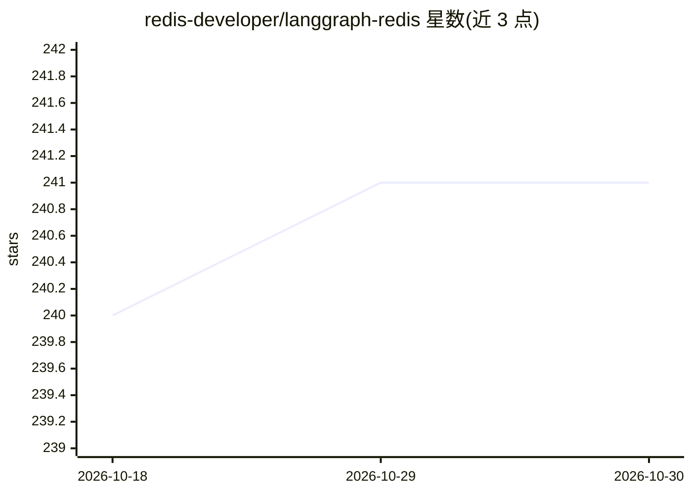

# redis-developer/langgraph-redis

⭐ 241 · Python · MIT · 推送 2026-10-24 · [GitHub](https://github.com/redis-developer/langgraph-redis) · [官网](http://redis-developer.github.io/langgraph-redis/) · 组织维护

**LangGraph 的 Redis 检查点存储与中间件库，供开发者持久化 agent 状态**

为 LangGraph 提供 Redis 后端的三个组件：Checkpoint Savers（同步/异步/浅层实现）存储和管理图执行检查点；Redis Stores 提供键值存储并支持可选向量检索；以及面向 LangChain agent 的中间件（语义缓存、工具结果缓存、对话记忆、语义路由）。支持 TTL 自动过期与持久化、可共享 Redis 连接。依赖 RedisJSON 与 RediSearch 模块（Redis 8.0+ 内置，低版本需 Redis Stack），并给出 Azure Managed Redis / Redis Enterprise 的代理层配置说明。以 pip 包形式发布。

## 筛选速览

| 维度 | 判定 | 备注 |
|---|---|---|
| AI 角色 | `ai-ecosystem` | LLM/agent 周边工具 |
| 许可风险 | `permissive` | MIT |
| 部署形态 | `self-host` | docker 或自建部署 |
| 模型依赖 | — | README 未给出锁定关系 |
| 硬件要求 | — | 无带数字的原话,不猜 |
| 安装摩擦 | `low` | 无编译、无系统依赖或容器化 |
| 成熟度 | — | 结构信号不足 |

## 能力要点

- 同步/异步/浅层三类 Redis Checkpoint Saver
- Redis Stores 支持可选向量相似度检索
- 四种中间件：语义缓存、工具缓存、对话记忆、语义路由
- 基于 Redis 原生 TTL 的检查点过期与持久化（pinning）机制

## 适用场景

- 为 LangGraph agent 提供跨线程的持久化记忆
- 用语义缓存降低 LLM 调用成本与延迟
- 缓存昂贵工具调用结果（API 调用、计算）
- 将语义相关的历史消息注入 agent 上下文

## 场景标签

`Agent 记忆` · 领域:Agent 开发

## 证据(README 行号)

> L15: This repository contains Redis implementations for LangGraph, providing both Checkpoint Savers and Stores functiona
> L21: 1. **Redis Checkpoint Savers**: Implementations for storing and managing checkpoints using Redis
> L23: 3. **Redis Middleware**: LangChain agent middleware for semantic caching, tool caching, and conversation memory

## 星数曲线

2026-10-18 240 → 2026-10-30 241（+1）

---
*卡片 v1 · prompt 1.4 · 生成 2026-10-22 · 置信度 high · 依据 README sha `d4cafcc9d644` · [字段定义](../../DATASET.md)*
