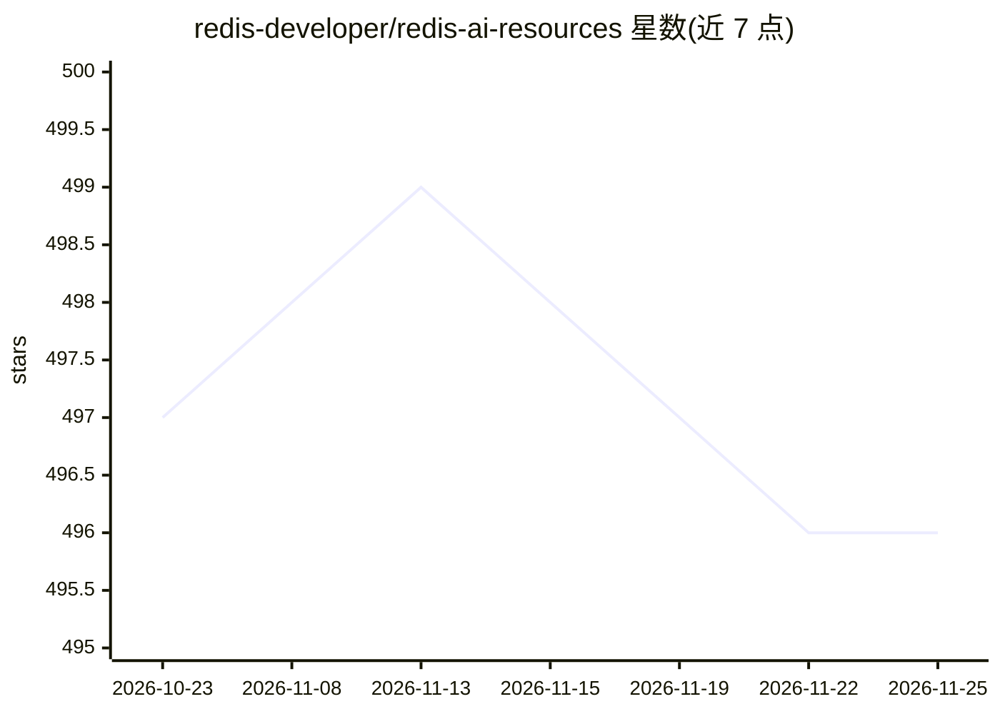

# redis-developer/redis-ai-resources

⭐ 496 · Jupyter Notebook · MIT · 推送 2026-11-23 · [GitHub](https://github.com/redis-developer/redis-ai-resources) · 组织维护

**Redis 在 AI 生态中的代码配方、演示与教程策展清单**

面向使用 Redis 构建 AI 应用的开发者，收录代码配方、在线演示、教程与集成资源，按入门、向量搜索、RAG、LLM 记忆、语义缓存、语义路由、AI 网关、Agent、计算机视觉、推荐系统、欺诈检测、特征存储、MCP、Agent Memory 等主题组织，多数配方提供 GitHub 与 Google Colab 双入口，另含 /java-recipes 下的 Java 配方与 Spring AI notebook。MIT 许可。

## 筛选速览

| 维度 | 判定 | 备注 |
|---|---|---|
| AI 角色 | `ai-knowledge` | 知识聚合/清单类 |
| 许可风险 | `permissive` | MIT |
| 部署形态 | `None` |  |
| 模型依赖 | — | README 未给出锁定关系 |
| 硬件要求 | — | 无带数字的原话,不猜 |
| 安装摩擦 | `low` | 无编译、无系统依赖或容器化 |
| 成熟度 | — | 结构信号不足 |

## 能力要点

- 数十个覆盖 RAG/向量搜索/语义缓存/Agent 等主题的 notebook 配方
- 多个可交互演示（RAG Workbench、Streamlit 向量搜索、Agent 助手等）
- 每个配方提供 GitHub 与 Google Colab 两种打开方式
- 含 MCP Server、Agent Memory Server、Java/Spring AI 配方等专项章节

## 适用场景

- 为 Redis 向量搜索和 RAG 应用查找入门配方
- 参考语义缓存/路由、Agent 记忆等场景的实现示例
- 在 Colab 中直接运行 Redis AI 相关 notebook

## 场景标签

`精选清单` `教程课程` `RAG` `向量数据库` · 领域:知识与检索

## 证据(README 行号)

> L11:  ✨ A curated repository of code recipes, demos, tutorials and resources for basic and advanced Redis use cases in t
> L55: ### Getting started with Redis & Vector Search
> L113: ### AI Gateways

## 星数曲线

2026-10-23 497 → 2026-11-25 496（-1）

---
*卡片 v1 · prompt 1.4 · 生成 2026-11-25 · 置信度 high · 依据 README sha `57a79a386e60` · [字段定义](../../DATASET.md)*
