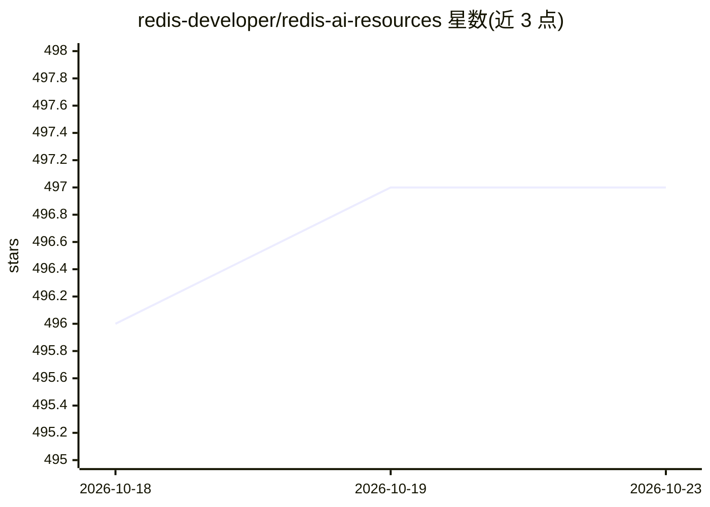

# redis-developer/redis-ai-resources

⭐ 497 · Jupyter Notebook · MIT · 推送 2026-10-21 · [GitHub](https://github.com/redis-developer/redis-ai-resources) · 组织维护

**Redis 在 AI 生态中的资源策展清单：示例、教程与集成**

由 Redis 开发者关系团队维护的策展仓库，汇集在 AI 场景中使用 Redis 的代码配方、演示、教程与集成资源：涵盖向量搜索、RAG、LLM 记忆、语义缓存、语义路由、AI 网关、Agent、计算机视觉、推荐系统、欺诈检测、特征存储与 MCP 等类别。配方以 Notebook 形式提供，可在 GitHub 或 Google Colab 打开，另收录多个可运行的完整演示工程和 Java 配方集。面向在 AI 应用中采用 Redis 的开发者。

## 筛选速览

| 维度 | 判定 | 备注 |
|---|---|---|
| AI 角色 | `ai-knowledge` | 知识聚合/清单类 |
| 许可风险 | `permissive` | MIT |
| 部署形态 | `None` |  |
| 模型依赖 | — | README 未给出锁定关系 |
| 硬件要求 | — | 无带数字的原话,不猜 |
| 安装摩擦 | `low` | 无编译、无系统依赖或容器化 |
| 成熟度 | — | 结构信号不足 |

## 能力要点

- 按向量搜索、RAG、语义缓存、Agent、特征存储等十余个类别组织配方
- 每个配方提供 GitHub 与 Google Colab Notebook 入口
- 收录 Redis RAG Workbench 等多个可运行的完整演示工程
- 包含独立 Java AI 配方集（/java-recipes）

## 适用场景

- 查找用 Redis 做向量检索与 RAG 的入门示例
- 为 LLM 应用选型语义缓存、语义路由或 Agent 记忆方案时找参考实现
- 了解 Redis 与 LangChain、LlamaIndex、Feast 等框架的集成方式

## 场景标签

`精选清单` · 领域:学习与行业

## 证据(README 行号)

> L11:  ✨ A curated repository of code recipes, demos, tutorials and resources for basic and advanced Redis use cases in t
> L51: ## Recipes

## 星数曲线

2026-10-18 496 → 2026-10-23 497（+1）

---
*卡片 v1 · prompt 1.4 · 生成 2026-10-21 · 置信度 high · 依据 README sha `76485ce5e5ad` · [字段定义](../../DATASET.md)*
