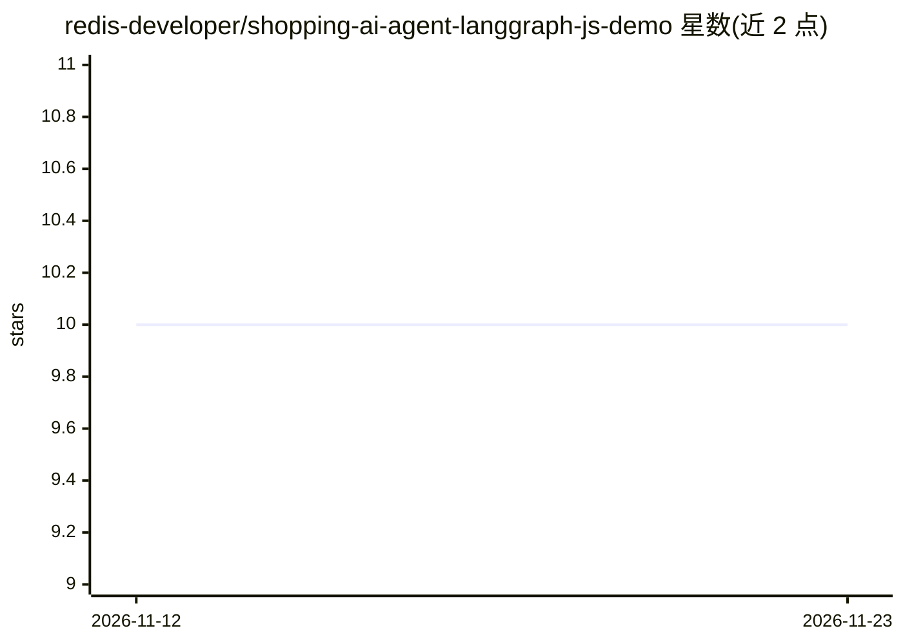

# redis-developer/shopping-ai-agent-langgraph-js-demo

⭐ 10 · TypeScript · MIT · 推送 2026-11-14 · [GitHub](https://github.com/redis-developer/shopping-ai-agent-langgraph-js-demo) · [官网](https://tryredish.vercel.app/) · 个人维护

**面向开发者的生鲜电商 AI 购物助手 LangGraph.js 示例**

基于 Node.js/Express + Redis + LangGraph.js 的生鲜电商示例应用，提供聊天式购物助手：语义搜索选品、按菜谱推荐食材、自然语言管理购物车，回复以 SSE 流式返回。关键机制包括 Redis LangCache 语义缓存（相似问题直接复用答案）、Redis Agent Memory 存储对话与购物偏好、多工具 Agent 路由，并支持 Redis Context Retriever（可选）将商品目录与购物车暴露为 MCP 工具。README 定位为帮助开发者学习 embeddings、向量搜索、语义缓存、agent memory 与 tool-calling 的教学演示，需 Redis Cloud（JSON+Search 能力）并自配 AI 提供商。

## 筛选速览

| 维度 | 判定 | 备注 |
|---|---|---|
| AI 角色 | `ai-ecosystem` | LLM/agent 周边工具 |
| 许可风险 | `permissive` | MIT |
| 部署形态 | `self-host` | docker 或自建部署 |
| 模型依赖 | locked-api |  |
| 硬件要求 | — | 无带数字的原话,不猜 |
| 安装摩擦 | `low` | 无编译、无系统依赖或容器化 |
| 成熟度 | — | 结构信号不足 |

## 能力要点

- Redis LangCache 语义缓存：相似问题即时复用历史答案
- Redis Agent Memory 跨会话记忆购物偏好（含自定义 shopper_preference 记忆类型）
- 双提供商切换：AI_PROVIDER 支持 openai 与 aws-bedrock（含 Bedrock Guardrails）
- 可选 Redis Context Retriever 将商品/购物车转为 MCP 工具（仅 openai 1536 维向量）

## 适用场景

- 搭建带 AI 购物助手的电商原型
- 学习语义缓存、agent memory 与工具调用工作流的组合方式
- 体验向量搜索驱动的商品推荐与菜谱食材推荐

## 场景标签

`聊天机器人` `语义搜索` · 领域:对话与助手

## 证据(README 行号)

> L271: This project is a learning-focused demonstration designed to help developers understand:
> L273: - **AI building blocks**: embeddings and vector search, semantic caching, agent memory, and tool-calling workflows

## 星数曲线

2026-11-12 10 → 2026-11-23 10（+0）

---
*卡片 v1 · prompt 1.4 · 生成 2026-11-19 · 置信度 high · 依据 README sha `ed6bc65ea0c3` · [字段定义](../../DATASET.md)*
