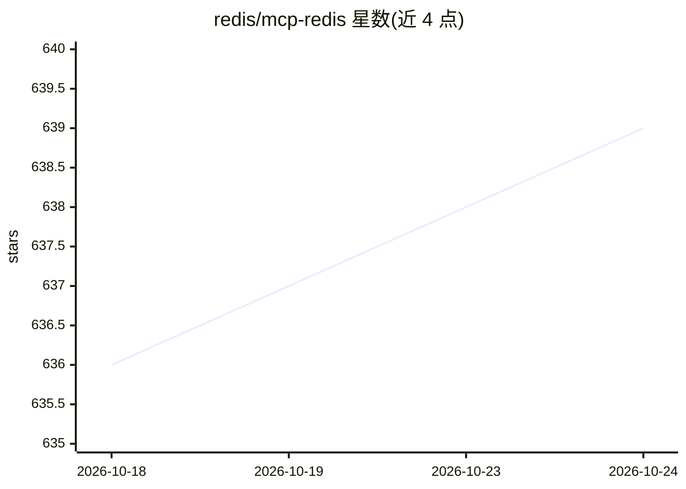

# redis/mcp-redis

⭐ 640 · Python · MIT · 推送 2026-10-20 · [GitHub](https://github.com/redis/mcp-redis) · [官网](https://redis.io/docs/latest/integrate/redis-mcp/) · 组织维护

**官方 Redis MCP Server：让 AI agent 用自然语言管理 Redis 数据**

Redis 官方维护的 MCP Server，为 agentic 应用提供自然语言接口来管理、检索 Redis 数据。提供 string/hash/list/set/sorted set/pub-sub/streams/JSON 等数据结构操作工具，以及向量索引与向量搜索、Redis 文档自然语言检索、数据库信息查询等附加工具。通过 stdio 传输与任意 MCP 客户端集成（streamable-http 计划未来支持），支持 redis/rediss URI 连接、SSL/TLS、Redis Cluster、Redis ACL，并原生支持 Azure Managed Redis 的 EntraID（OAuth）三种认证流程。以 PyPI 包、GitHub 源码与 Docker 镜像三种方式分发。

## 筛选速览

| 维度 | 判定 | 备注 |
|---|---|---|
| AI 角色 | `ai-ecosystem` | LLM/agent 周边工具 |
| 许可风险 | `permissive` | MIT |
| 部署形态 | `self-host` | docker 或自建部署 |
| 模型依赖 | — | README 未给出锁定关系 |
| 硬件要求 | — | 无带数字的原话,不猜 |
| 安装摩擦 | `low` | 无编译、无系统依赖或容器化 |
| 成熟度 | — | 结构信号不足 |

## 能力要点

- 覆盖 Redis 全部核心数据结构（含 streams、JSON、pub/sub）的操作工具集
- 向量索引管理与向量搜索工具
- Azure Managed Redis 的 EntraID 认证（Service Principal/Managed Identity/Default Credential）
- 支持 Redis ACL、TLS 与 Cluster 模式，可经 CLI 参数或环境变量配置

## 适用场景

- 在 Claude Desktop 等 MCP 客户端中直接读写 Redis 数据
- 让 AI agent 在 Redis 中缓存、检索数据并执行向量搜索
- 基于 Redis Streams 记录 agent 会话与事件流

## 场景标签

 · 领域:数据库/AI 基础设施

## 证据(README 行号)

> L18: The Redis MCP Server is a **natural language interface** designed for agentic applications to efficiently manage an
> L29: - **Seamless MCP Integration**: Works with any **MCP client** for smooth communication.

## 星数曲线

2026-10-18 636 → 2026-10-24 639（+3）

---
*卡片 v1 · prompt 1.4 · 生成 2026-10-22 · 置信度 mid · 依据 README sha `a7bcbb7b687e` · [字段定义](../../DATASET.md)*
