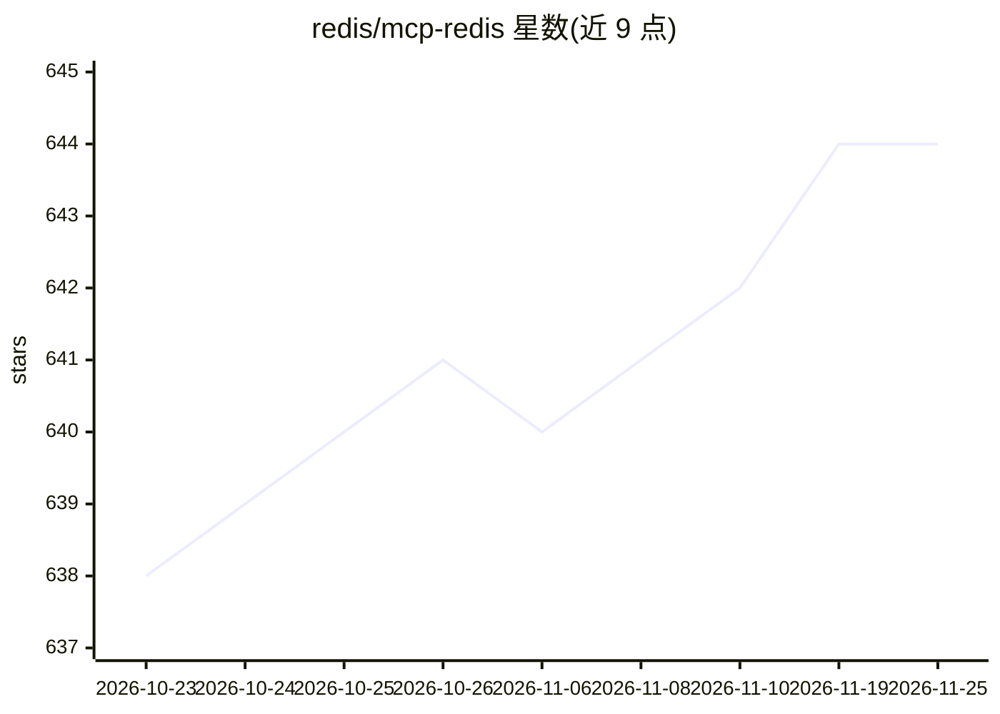

# redis/mcp-redis

⭐ 644 · Python · MIT · 推送 2026-11-23 · [GitHub](https://github.com/redis/mcp-redis) · [官网](https://redis.io/docs/latest/integrate/redis-mcp/) · 组织维护

**供 MCP 客户端/AI agent 用自然语言管理 Redis 数据的服务器**

Redis 官方维护的 MCP Server，为 MCP 客户端提供操作 Redis 的工具集：覆盖 string、hash、list、set、sorted set、pub/sub、streams、JSON 等数据类型，并含向量索引与检索、Redis 文档搜索、服务器信息查询等扩展工具。支持 stdio 传输、redis/rediss 连接 URI、SSL/TLS、Redis Cluster、Redis ACL 只读用户、EntraID（Azure AD）认证，可通过环境变量 MCP_REDIS_ALLOWED_TOOLS 限制暴露的工具。以 PyPI 包、GitHub 源码、Docker 镜像（含官方 mcp/redis 镜像）分发。

## 筛选速览

| 维度 | 判定 | 备注 |
|---|---|---|
| AI 角色 | `ai-ecosystem` | LLM/agent 周边工具 |
| 许可风险 | `permissive` | MIT |
| 部署形态 | `self-host` | docker 或自建部署 |
| 模型依赖 | — | README 未给出锁定关系 |
| 硬件要求 | — | 无带数字的原话,不猜 |
| 安装摩擦 | `low` | 无编译、无系统依赖或容器化 |
| 成熟度 | — | 结构信号不足 |

## 能力要点

- 提供 string/hash/list/set/sorted set/pub-sub/streams/JSON 全套 Redis 操作工具
- 向量索引管理与向量搜索工具
- 支持 stdio 传输、SSL/TLS、Redis Cluster、ACL 与 EntraID 认证
- 支持 PyPI/uvx、GitHub 源码与官方 Docker 镜像三种分发方式

## 适用场景

- 让 Claude Desktop 等 MCP 客户端用自然语言读写与检索 Redis 数据
- 在 AI agent 工作流中缓存会话、消息流与向量数据
- 限制 agent 可调用的 Redis 工具范围以收敛权限

## 场景标签

 · 领域:数据库/AI Agent 基础设施

## 证据(README 行号)

> L18: The Redis MCP Server is a **natural language interface** designed for agentic applications to efficiently manage an
> L29: - **Seamless MCP Integration**: Works with any **MCP client** for smooth communication.
> L34: - The Redis MCP Server supports the `stdio` transport. Support to the `stremable-http` transport will be added in t

## 星数曲线

2026-10-23 638 → 2026-11-25 644（+6）

---
*卡片 v1 · prompt 1.4 · 生成 2026-11-25 · 置信度 mid · 依据 README sha `2bf551d4db68` · [字段定义](../../DATASET.md)*
