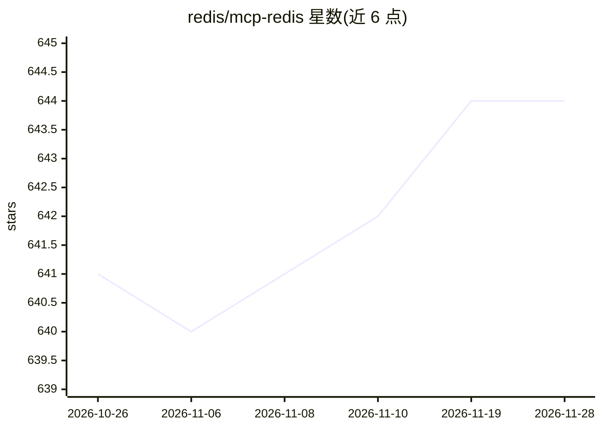

# redis/mcp-redis

⭐ 644 · Python · MIT · 推送 2026-11-27 · [GitHub](https://github.com/redis/mcp-redis) · [官网](https://redis.io/docs/latest/integrate/redis-mcp/) · 组织维护

**Redis 官方 MCP 服务器：让 AI 代理用自然语言管理并检索 Redis 数据**

Redis 官方维护的 MCP 服务器，为代理型应用提供自然语言接口来操作 Redis 数据。以 MCP 工具形式暴露 string、hash、list、set、sorted set、pub/sub、streams、JSON 文档的读写操作，另含向量索引与检索、Redis 文档搜索、服务器信息查询工具。通过 CLI 参数或环境变量配置连接（URI、SSL/TLS、集群模式），支持 Redis ACL 限权与白名单式工具暴露控制，支持 EntraID 认证接入 Azure Managed Redis。传输支持 stdio，streamable-http 待加入。以 PyPI 包、GitHub 源码、Docker 镜像三种方式分发。

## 筛选速览

| 维度 | 判定 | 备注 |
|---|---|---|
| AI 角色 | `ai-ecosystem` | LLM/agent 周边工具 |
| 许可风险 | `permissive` | MIT |
| 部署形态 | `self-host` | docker 或自建部署 |
| 模型依赖 | — | README 未给出锁定关系 |
| 硬件要求 | — | 无带数字的原话,不猜 |
| 安装摩擦 | `low` | 无编译、无系统依赖或容器化 |
| 成熟度 | — | 结构信号不足 |

## 能力要点

- 覆盖 hash/list/set/sorted set/streams/JSON 等 Redis 数据结构的 MCP 工具集
- 向量索引与向量检索工具
- 支持 Redis ACL 与 MCP_REDIS_ALLOWED_TOOLS 工具白名单控制
- EntraID 认证接入 Azure Managed Redis（服务主体/托管身份）

## 适用场景

- 让 MCP 客户端中的 AI 代理用自然语言读写与检索 Redis 数据
- 为会话/缓存/消息流等场景由代理执行存储指令
- 通过向量检索工具在 Redis 中做语义搜索
- 以只读 ACL 与工具白名单限定代理可执行的操作范围

## 场景标签

 · 领域:数据库/AI 代理基础设施

## 证据(README 行号)

> L18: The Redis MCP Server is a **natural language interface** designed for agentic applications to efficiently manage an
> L29: - **Seamless MCP Integration**: Works with any **MCP client** for smooth communication.
> L34: - The Redis MCP Server supports the `stdio` transport. Support to the `stremable-http` transport will be added in t

## 星数曲线

2026-10-26 641 → 2026-11-28 644（+3）

---
*卡片 v1 · prompt 1.4 · 生成 2026-11-26 · 置信度 mid · 依据 README sha `569a8f115836` · [字段定义](../../DATASET.md)*
