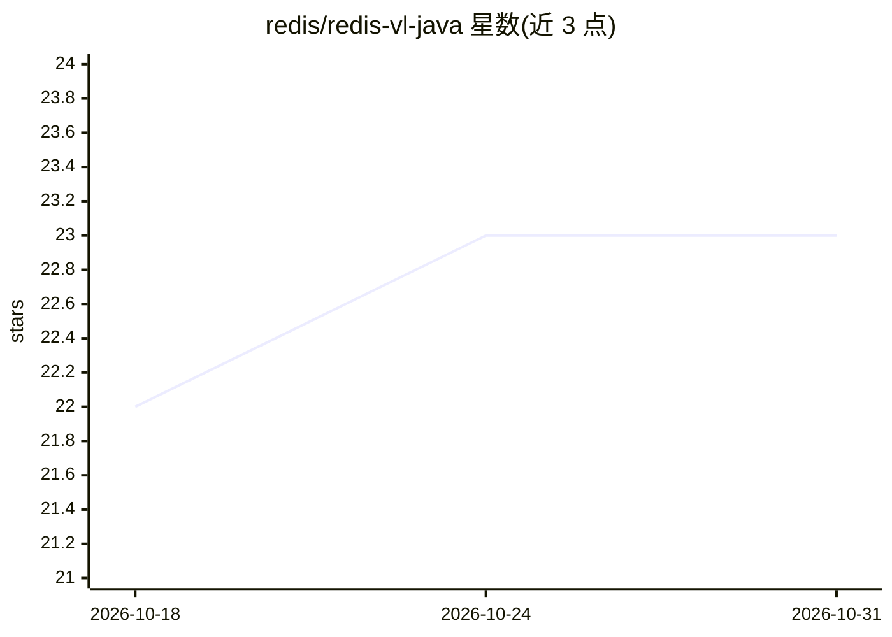

# redis/redis-vl-java

⭐ 23 · Java · MIT · 推送 2026-06-05 · [GitHub](https://github.com/redis/redis-vl-java) · [官网](https://redis.github.io/redis-vl-java/) · 组织维护

**面向 AI 应用的 Redis Java 客户端：向量检索/RAG/语义缓存**

Redis 官方维护的 Java 17+ 向量库客户端，构建于 Jedis 之上，供 Java 团队在 Redis 上构建 AI 应用。提供 YAML/Java 定义索引 schema、向量/文本/混合查询、数据加载，集成 LangChain4J 嵌入模型（OpenAI/Cohere/Ollama 等）、ONNX 本地嵌入模型与 DJL，扩展包含 LLM 语义缓存、语义路由、消息历史。HybridQuery 需 Redis 8.4+，低版本走 FT.AGGREGATE 回退路径。另含实验性 VCR 测试系统用于录制回放 LLM API 调用。

## 筛选速览

| 维度 | 判定 | 备注 |
|---|---|---|
| AI 角色 | `ai-ecosystem` | LLM/agent 周边工具 |
| 许可风险 | `permissive` | MIT |
| 部署形态 | `self-host` | docker 或自建部署 |
| 模型依赖 | local-ok | 支持本地模型 |
| 硬件要求 | — | 无带数字的原话,不猜 |
| 安装摩擦 | `low` | 无编译、无系统依赖或容器化 |
| 成熟度 | — | 结构信号不足 |

## 能力要点

- YAML/Java schema 定义与 SearchIndex 索引管理
- 向量、混合、过滤、计数等多种查询类型
- LangChain4J / ONNX / DJL 向量化器与 Cohere/HuggingFace 重排序集成
- 语义缓存、语义路由扩展与实验性 VCR 测试系统

## 适用场景

- Java 团队在 Redis 上构建向量检索层或 RAG 后端
- 通过 LangChain4J 适配器接入 Redis 做检索链
- 为 LLM 应用加语义缓存与语义路由

## 场景标签

`向量数据库` `RAG` · 领域:知识与检索

## 证据(README 行号)

> L20: Redis Vector Library (RedisVL) is the ultimate Java client designed for AI-native applications harnessing the power
> L336: - Define Redis search/index schemas in YAML or Java
> L340: - Integrate Redis into LangChain4J-based RAG systems

## 星数曲线

2026-10-18 22 → 2026-10-31 23（+1）

---
*卡片 v1 · prompt 1.4 · 生成 2026-10-27 · 置信度 mid · 依据 README sha `5086a08821ef` · [字段定义](../../DATASET.md)*
