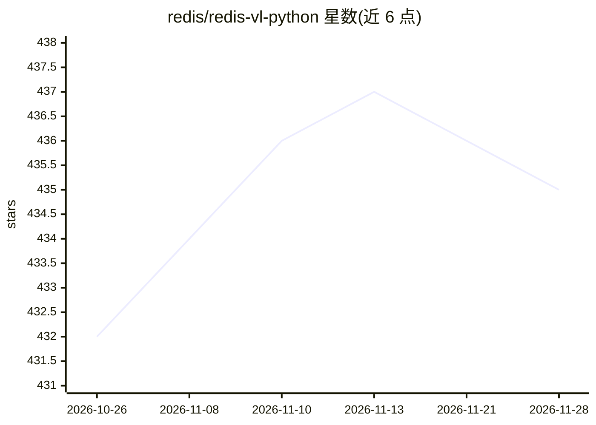

# redis/redis-vl-python

⭐ 435 · Python · MIT · 推送 2026-11-27 · [GitHub](https://github.com/redis/redis-vl-python) · [官网](https://docs.redisvl.com) · 组织维护

**面向 AI 应用开发者的 Redis 向量搜索 Python 客户端**

RedisVL 是构建在 Redis 之上的 Python 客户端（Python >=3.11），提供索引 schema 设计（YAML/字典）、向量搜索、复杂过滤、混合检索（语义 + BM25）、数据加载与 CRUD 等核心能力，并附带异步索引类、rvl 命令行工具和 MCP Server（可经 stdio/Streamable HTTP/SSE 暴露 Redis 索引给 MCP 客户端）。扩展模块包括语义缓存、嵌入缓存、LLM 会话记忆与语义路由，面向构建 RAG、Agent 记忆、推荐系统等 AI 应用的开发者。维护方为 Redis, Inc。

## 筛选速览

| 维度 | 判定 | 备注 |
|---|---|---|
| AI 角色 | `ai-ecosystem` | LLM/agent 周边工具 |
| 许可风险 | `permissive` | MIT |
| 部署形态 | `self-host` | docker 或自建部署 |
| 模型依赖 | — | README 未给出锁定关系 |
| 硬件要求 | — | 无带数字的原话,不猜 |
| 安装摩擦 | `low` | 无编译、无系统依赖或容器化 |
| 成熟度 | — | 结构信号不足 |

## 能力要点

- 向量搜索、复杂过滤与混合检索（语义 + BM25），支持 6 种查询类型
- 语义缓存、嵌入缓存、LLM 记忆、语义路由四个扩展模块
- MCP Server 将已有 Redis 索引暴露给 MCP 客户端（stdio/HTTP/SSE 传输）
- rvl CLI 与异步 AsyncSearchIndex 支持

## 适用场景

- 为 RAG 管道搭建实时向量检索层
- 用语义缓存降低 LLM 调用成本
- 管理 Agent 的会话记忆与查询语义路由
- 通过 MCP 客户端搜索/写入已有 Redis 索引

## 场景标签

`向量数据库` `RAG` `Agent 记忆` `推荐系统` · 领域:Agent 开发

## 证据(README 行号)

> L18: Redis Vector Library (RedisVL) is the production-ready Python client for AI applications built on Redis. **Lightnin
> L233: **RedisVL Extensions** provide production-ready modules implementing best practices and design patterns for workin
> L342: RedisVL includes an MCP server that lets MCP-compatible clients search or upsert data in one or more existing Redi

## 星数曲线

2026-10-26 432 → 2026-11-28 435（+3）

---
*卡片 v1 · prompt 1.4 · 生成 2026-11-28 · 置信度 mid · 依据 README sha `046674c99ff1` · [字段定义](../../DATASET.md)*
