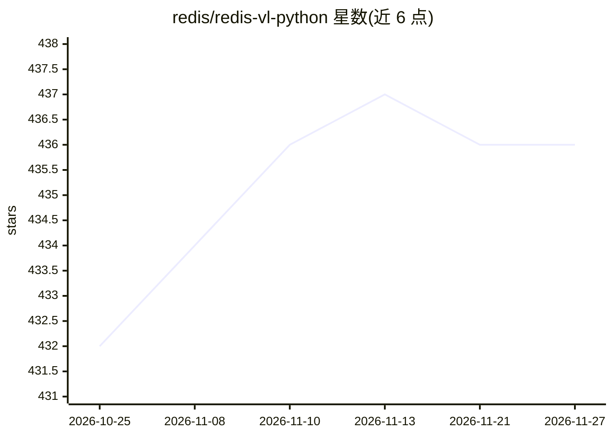

# redis/redis-vl-python

⭐ 436 · Python · MIT · 推送 2026-11-25 · [GitHub](https://github.com/redis/redis-vl-python) · [官网](https://docs.redisvl.com) · 组织维护

**面向 AI 应用开发者的 Redis 向量检索 Python 客户端**

RedisVL 是 Redis 官方发布的 Python 客户端库，围绕 Redis 的向量搜索能力为 AI 应用提供基础设施组件：通过 YAML 或字典定义索引 schema，支持向量查询、距离范围查询、元数据过滤、BM25 全文与混合搜索；附带 8+ 家 embedding 提供商的向量化封装、重排序器、语义缓存、embedding 缓存、会话记忆与语义路由扩展；提供 rvl 命令行工具管理索引，并内置可将 Redis 索引暴露给 MCP 客户端的 MCP 服务器。支持同步与异步接口，要求 Python >=3.11，混合搜索的 HybridQuery 需 Redis 8.4.0+。

## 筛选速览

| 维度 | 判定 | 备注 |
|---|---|---|
| AI 角色 | `ai-ecosystem` | LLM/agent 周边工具 |
| 许可风险 | `permissive` | MIT |
| 部署形态 | `self-host` | docker 或自建部署 |
| 模型依赖 | — | README 未给出锁定关系 |
| 硬件要求 | — | 无带数字的原话,不猜 |
| 安装摩擦 | `low` | 无编译、无系统依赖或容器化 |
| 成熟度 | — | 结构信号不足 |

## 能力要点

- 向量搜索、复杂过滤与混合搜索（语义+BM25）查询类型
- 语义缓存与 embedding 缓存，降低 LLM 调用成本
- LLM 会话记忆与语义路由扩展
- MCP 服务器支持 stdio/Streamable HTTP/SSE 三种传输

## 适用场景

- 为 RAG 应用搭建实时向量检索与混合搜索
- 为 LLM 应用加一层语义缓存减少重复调用开销
- 管理 agent 的会话记忆与查询语义路由
- 通过 MCP 把已有 Redis 索引接入 MCP 客户端

## 场景标签

`向量数据库` `语义搜索` · 领域:知识与检索

## 证据(README 行号)

> L18: Redis Vector Library (RedisVL) is the production-ready Python client for AI applications built on Redis. **Lightnin
> L23: |:---:|:---:|:---:|
> L376: Redis is a proven, high-performance database that excels at real-time workloads. With RedisVL, you get a productio

## 星数曲线

2026-10-25 432 → 2026-11-27 436（+4）

---
*卡片 v1 · prompt 1.4 · 生成 2026-11-25 · 置信度 mid · 依据 README sha `ffb3adfe912d` · [字段定义](../../DATASET.md)*
