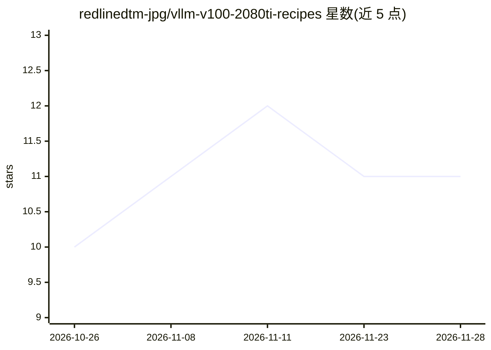

# redlinedtm-jpg/vllm-v100-2080ti-recipes

⭐ 11 · MIT · 推送 2026-08-19 · [GitHub](https://github.com/redlinedtm-jpg/vllm-v100-2080ti-recipes) · [官网](https://nextgen-pc.online/) · 个人维护

**在 V100/2080 Ti 等旧 NVIDIA GPU 上运行大型 LLM 的实测指南集**

面向持有 Volta（sm_70）与 Turing（sm_75）架构 GPU 的用户的经验文档集：记录各架构可用的 vLLM fork（1Cat、weicj）与启动参数、兼容性矩阵、注意力后端与量化限制，并给出 V100/2080 Ti/A100/4090 上的实测 tokens/s 数据与并发曲线。硬件侧涵盖 SXM2 载板 NVLink 排障、驱动陷阱（开源内核模块不支持 Volta）、二手 V100 验收清单与被动散热卡冷却。内容为作者自测数据，非厂商宣称。

## 筛选速览

| 维度 | 判定 | 备注 |
|---|---|---|
| AI 角色 | `ai-knowledge` | 知识聚合/清单类 |
| 许可风险 | `permissive` | MIT |
| 部署形态 | `None` |  |
| 模型依赖 | local-ok | 支持本地模型 |
| 硬件要求 | — | 无带数字的原话,不猜 |
| 安装摩擦 | `high` | 编译与系统依赖俱全 |
| 成熟度 | — | 结构信号不足 |

## 能力要点

- V100/2080 Ti/4090 的 vLLM 兼容性矩阵与可用 fork 对应表
- 实测基准数据：4×V100 跑 122B MoE 模型 64 并发 1059 tok/s
- 硬件排障指南：NVLink 链路训练失败、BAR0 为 0M 的驱动问题、二手卡验收清单
- 内存带宽决定推理速度的量化分析与并行拓扑选择方法

## 适用场景

- 手头有 V100 或 2080 Ti 想部署大模型推理
- 排查旧卡上 vLLM 量化内核无法加载的问题
- 采购二手 V100 SXM2 套件前做验收检测

## 场景标签

`推理引擎` `教程课程` · 领域:学习与行业

## 证据(README 行号)

> L3: Working recipes, hard-won gotchas and **real measured benchmarks** for serving large language models on pre-Ampere N
> L26: - **Benchmarks** — measured tokens/s across V100, 2080 Ti, A100 and 4090-48GB.
> L55: Full tables — concurrency curves, power draw, A100-vs-V100 across load levels, and the failures — in docs/benchmark

## 星数曲线

2026-10-26 10 → 2026-11-28 11（+1）

---
*卡片 v1 · prompt 1.4 · 生成 2026-11-18 · 置信度 high · 依据 README sha `016f703cb8e3` · [字段定义](../../DATASET.md)*
