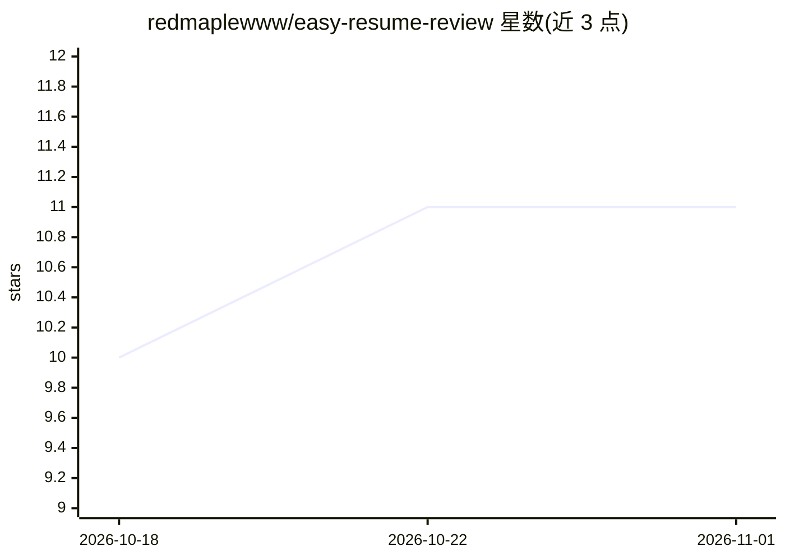

# redmaplewww/easy-resume-review

⭐ 11 · Python · MIT · 推送 2026-08-06 · [GitHub](https://github.com/redmaplewww/easy-resume-review) · 个人维护 · 中文 README

**私有部署的 AI 技术简历审查平台：七维评分+两轮复核**

面向招聘方筛选辅助的可私有部署 AI 简历审查平台，提供 Web 工作台、Tkinter 桌面端与 CLI 三种形态。聚焦 AI/LLM 工程岗位：LLM 审查结合确定性证据检测器，按角色匹配、真实性、项目深度等七维评分，识别技能堆砌、纯 API 包装、时间线矛盾等信号；本地 Tesseract 中英文 OCR 处理扫描件，不依赖视觉模型。支持 OpenAI 兼容端点、Docker/systemd 部署、多账号招聘漏斗与录用名额控制。项目自身声明不能替代面试与人工判断。

## 筛选速览

| 维度 | 判定 | 备注 |
|---|---|---|
| AI 角色 | `ai-native` | 本体是模型或模型工具 |
| 许可风险 | `permissive` | MIT |
| 部署形态 | `self-host` | docker 或自建部署 |
| 模型依赖 | — | README 未给出锁定关系 |
| 硬件要求 | — | 无带数字的原话,不猜 |
| 安装摩擦 | `low` | 无编译、无系统依赖或容器化 |
| 成熟度 | — | 结构信号不足 |

## 能力要点

- 七维评分 + 启发式证据检测 + 两轮模型复核
- 本地 Tesseract 中英文 OCR，无需视觉模型
- Web/桌面 GUI/CLI 三形态，支持 Docker 与 systemd 部署
- 招聘漏斗：租户隔离、名额原子扣减、微信客服简历入口

## 适用场景

- 我在招 AI/LLM 工程师，想批量初筛简历并区分真实项目深度
- 团队需要私有部署的简历审查工具，简历不出内网
- 为每个候选人生成带红旗与录用建议的 PDF 报告

## 场景标签

`OCR` · 领域:感知与多模态

## 证据(README 行号)

> L3: Easy Resume Review（Easy 简历审查）是一套可私有部署的 AI 技术简历审查平台，提供 Web、桌面端和 CLI。它聚焦 AI/LLM 工程岗位，通过七维评分、证据检测、本地 OCR 和两轮模型复核，区分真实项目
> L16: - **LLM provider agnostic**: uses the OpenAI Python SDK and supports OpenAI-compatible endpoints.

## 星数曲线

2026-10-18 10 → 2026-11-01 11（+1）

---
*卡片 v1 · prompt 1.4 · 生成 2026-11-01 · 置信度 mid · 依据 README sha `997e933b7e35` · [字段定义](../../DATASET.md)*
