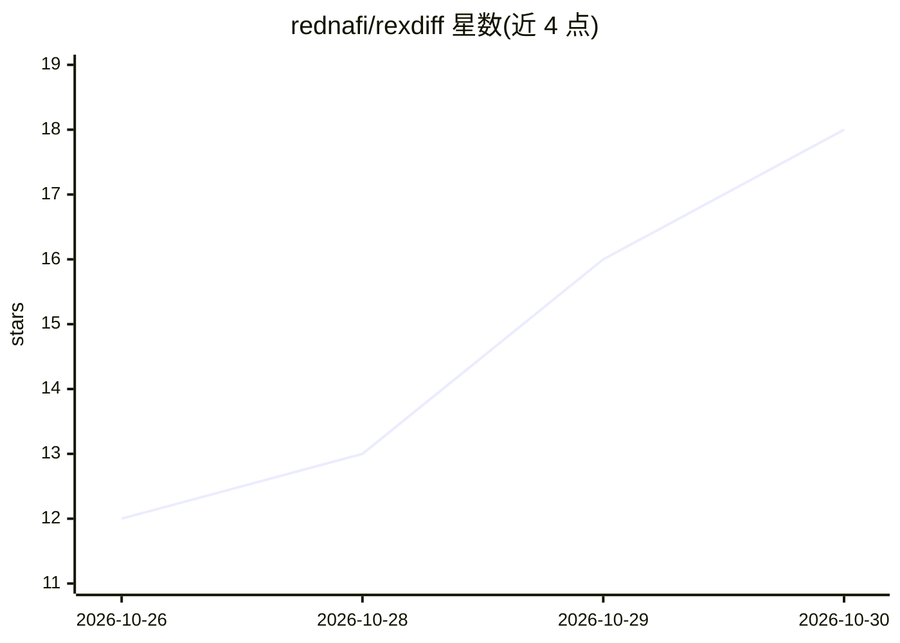

# rednafi/rexdiff

⭐ 18 · Go · MIT · 推送 2026-10-29 · [GitHub](https://github.com/rednafi/rexdiff) · 个人维护

**在 Rex 终端内查看 AI 编码代理改动差异的 CLI 工具**

面向使用 AI 编码代理（如 Claude Code、Codex 类）的开发者的 diff 查看器：在 Rex 终端中开一个窗格展示代理改动，支持 last-turn 范围只看代理最近一轮修改；按 s 键将评审注释粘贴回代理输入框，附文件与行号。安装方式为 brew tap + brew install --cask，随后运行 rexdiff install 完成集成，在代理旁按 Shift+Cmd+R 唤起。提供用户指南、架构文档与测试文档链接，macOS 平台，MIT 许可。

## 筛选速览

| 维度 | 判定 | 备注 |
|---|---|---|
| AI 角色 | `ai-enhanced` | 去掉 AI 部分产品仍成立 |
| 许可风险 | `permissive` | MIT |
| 部署形态 | `None` |  |
| 模型依赖 | — | README 未给出锁定关系 |
| 硬件要求 | — | 无带数字的原话,不猜 |
| 安装摩擦 | `low` | 无编译、无系统依赖或容器化 |
| 成熟度 | — | 结构信号不足 |

## 能力要点

- diff 在 Rex 窗格中与代理并排展示，无需切换应用
- last-turn 范围仅显示代理最近一轮的改动
- 按键将评审注释连同文件与行号粘贴回代理输入

## 适用场景

- 在终端里即时查看编码代理改了哪些代码
- 只关注代理最近一轮修改的差异
- 把评审意见直接发回给代理继续迭代

## 场景标签

`代码审查` · 领域:编码与开发

## 证据(README 行号)

> L4:  Review what your coding agent changed, without leaving Rex.
> L28: - The diff opens in a Rex pane beside the agent, so you don't switch apps.

## 星数曲线

2026-10-26 12 → 2026-10-30 18（+6）

---
*卡片 v1 · prompt 1.4 · 生成 2026-10-30 · 置信度 high · 依据 README sha `ee06bce00341` · [字段定义](../../DATASET.md)*
