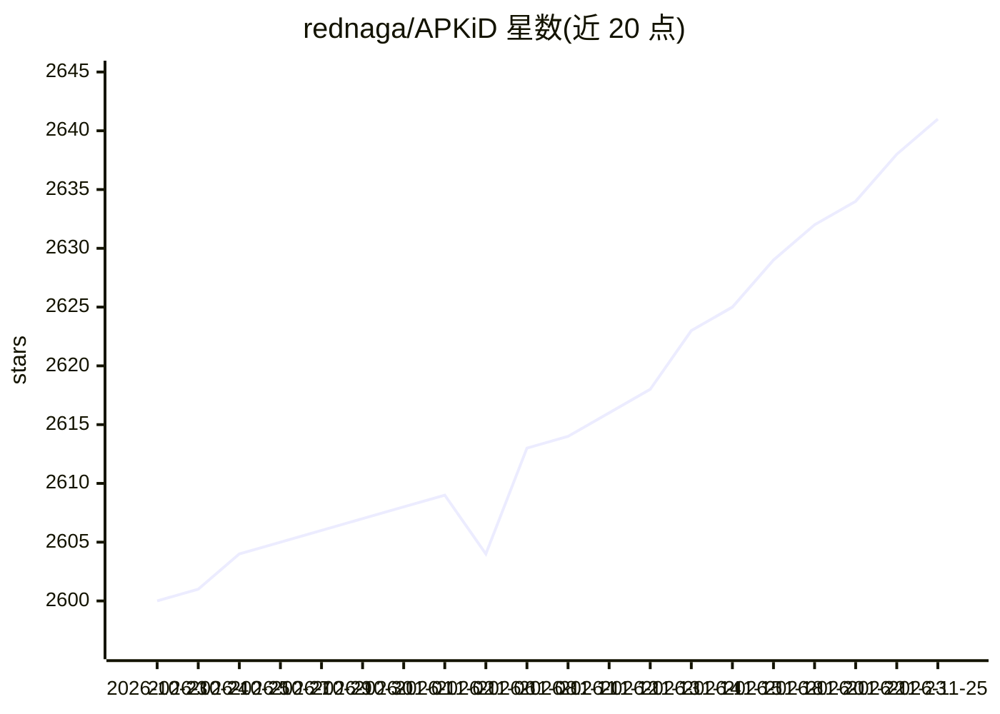

# rednaga/APKiD

⭐ 2,641 · YARA · NOASSERTION · 推送 2026-10-21 · [GitHub](https://github.com/rednaga/APKiD) · 组织维护

**面向 Android 安全分析者的 APK 构建方式识别工具**

APKiD 分析 APK/DEX 文件，识别其编译器、打包器、混淆器及反调试/反虚拟机等特征，定位为 Android 版 PEiD。以 pip 包与 Docker 镜像提供，命令行支持扫描深度、超时、JSON 输出等参数。识别基于规则库，开发者可通过 GitHub issue 提交新特征并以 pull request 贡献规则；规则更新后需用 prep-release.py 重新编译，开发依赖 yara-python 与 yara-python-dex。许可证为商业许可与 GPL 双许可。

## 筛选速览

| 维度 | 判定 | 备注 |
|---|---|---|
| AI 角色 | `ai-native` | 本体是模型或模型工具 |
| 许可风险 | `none` | NOASSERTION |
| 部署形态 | `self-host` | docker 或自建部署 |
| 模型依赖 | — | README 未给出锁定关系 |
| 硬件要求 | — | 无带数字的原话,不猜 |
| 安装摩擦 | `low` | 无编译、无系统依赖或容器化 |
| 成熟度 | — | 结构信号不足 |

## 能力要点

- 识别 APK/DEX 的编译器、打包器、混淆器等构建特征
- 支持检测 AppShielding 产品与移动 RASP SDK
- pip 安装与 Docker 两种运行方式
- 支持社区通过 issue/PR 提交新检测规则

## 适用场景

- 恶意 Android 应用分析中识别加壳与混淆手段
- 检测盗版应用使用的构建/保护工具
- 快速识别应用集成的 AppShielding 与 RASP SDK

## 场景标签

`网络安全` · 领域:学习与行业

## 证据(README 行号)

> L9: APKiD gives you information about how an APK was made. It identifies many compilers, packers, obfuscators, and other
> L43: usage: apkid [-h] [-v] [-t TIMEOUT] [-r] [--scan-depth SCAN_DEPTH]

## 星数曲线

2026-10-23 2,600 → 2026-11-25 2,641（+41）

---
*卡片 v1 · prompt 1.4 · 生成 2026-11-23 · 置信度 mid · 依据 README sha `b3d0f9678cad` · [字段定义](../../DATASET.md)*
