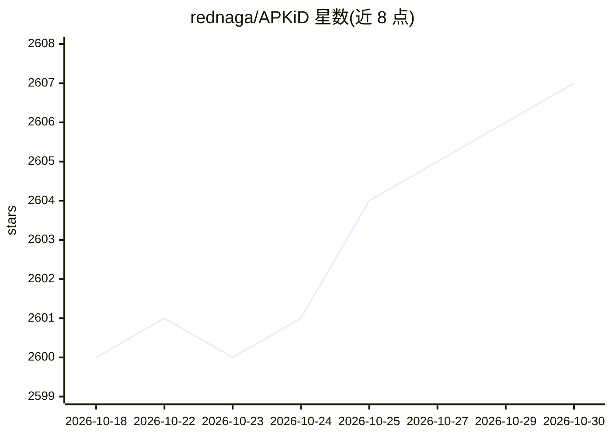

# rednaga/APKiD

⭐ 2,607 · YARA · NOASSERTION · 推送 2026-10-21 · [GitHub](https://github.com/rednaga/APKiD) · 个人维护

**识别 APK 编译器/加壳/混淆工具的静态分析工具**

APKiD 对 Android APK/DEX 文件做静态识别，输出其使用的编译器、加壳器、混淆器、AppShielding 与 RASP SDK 等信息，定位为 Android 版 PEiD。基于 YARA 规则匹配，通过 pip 安装为命令行工具，也提供 Docker 构建方式；支持自定义规则提交与社区扩充规则库。采用 GPL 与商业双许可。面向恶意软件分析与安全研究人员。

## 筛选速览

| 维度 | 判定 | 备注 |
|---|---|---|
| AI 角色 | `ai-native` | 本体是模型或模型工具 |
| 许可风险 | `none` | NOASSERTION |
| 部署形态 | `self-host` | docker 或自建部署 |
| 模型依赖 | — | README 未给出锁定关系 |
| 硬件要求 | — | 无带数字的原话,不猜 |
| 安装摩擦 | `low` | 无编译、无系统依赖或容器化 |
| 成熟度 | — | 结构信号不足 |

## 能力要点

- 识别 APK 中的编译器、加壳器、混淆器与 RASP SDK 等构件
- 基于 YARA 规则，支持社区提交新规则
- 提供 CLI 与 Docker 两种运行方式
- GPL/商业双许可

## 适用场景

- 分析可疑 APK 是否被加壳或混淆
- 识别盗版或恶意 Android 应用的构建来源
- 研究移动端 AppShielding 与 RASP 产品指纹

## 场景标签

`网络安全` · 领域:学习与行业

## 证据(README 行号)

> L9: APKiD gives you information about how an APK was made. It identifies many compilers, packers, obfuscators, and other
> L61: This tool is available under a dual license: a commercial one suitable for closed source projects and a GPL license

## 星数曲线

2026-10-18 2,600 → 2026-10-30 2,607（+7）

---
*卡片 v1 · prompt 1.4 · 生成 2026-10-21 · 置信度 high · 依据 README sha `19d7a6125b41` · [字段定义](../../DATASET.md)*
