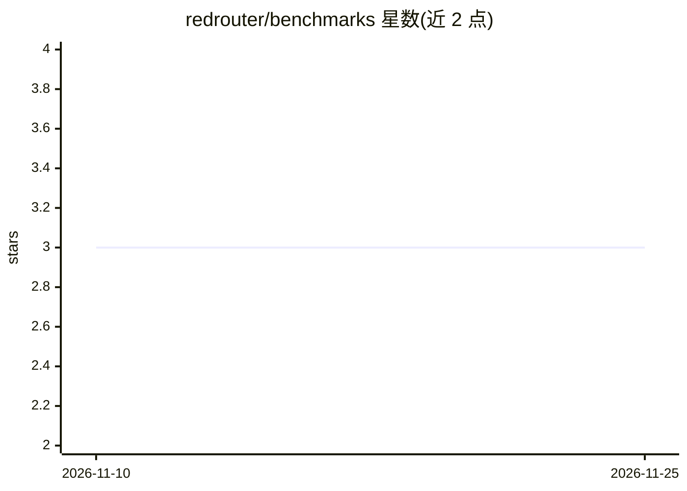

# redrouter/benchmarks

⭐ 3 · Python · Apache-2.0 · 推送 2026-11-18 · [GitHub](https://github.com/redrouter/benchmarks) · [官网](https://benchmarks.redrouter.org) · 组织维护

**面向 refusal-reduced 模型 API 的速度/可靠性/价格持续基准测量工具**

RedRouter 维护的持续基准测量项目：每 8 小时从 us-east-1 与 us-west-2 对提供 refusal-reduced 开源权重模型的推理 API 发起请求，测量首 token 时间、输出速度、端到端延迟、成功率与 3:1 混合价格，以 p50/p90 与 72 小时滚动窗口发布。结果发布在 benchmarks.redrouter.org 与 Hugging Face 数据集，本地可用 uv 生成演示数据并构建站点预览；原始记录保留失败请求，但不存储 API key、请求头、错误正文与生成文本，输入与时钟固定时输出可复现。

## 筛选速览

| 维度 | 判定 | 备注 |
|---|---|---|
| AI 角色 | `ai-ecosystem` | LLM/agent 周边工具 |
| 许可风险 | `permissive` | Apache-2.0 |
| 部署形态 | `None` |  |
| 模型依赖 | — | README 未给出锁定关系 |
| 硬件要求 | — | 无带数字的原话,不猜 |
| 安装摩擦 | `low` | 无编译、无系统依赖或容器化 |
| 成熟度 | — | 结构信号不足 |

## 能力要点

- 每 8 小时自动测量 TTFT、输出速度、端到端延迟、成功率与价格
- 提供无 key 的本地演示数据流程（模拟 transport 与时钟）
- 结果导出为带 Hugging Face 数据集卡的 summary/history CSV
- 失败请求保留不重试；不存储 API key 与生成文本

## 适用场景

- 在接入前查询各推理 API 提供方的延迟、成功率和价格表现
- 本地复现基准运行并构建自托管的结果站点
- 将基准数据导出为 CSV/数据集用于下游分析

## 场景标签

`模型评测` · 领域:评测与运维

## 证据(README 行号)

> L3: Continuous, reproducible measurements of inference APIs serving refusal-reduced open-weight models, with standard-mo
> L20: Latency and speed are reported as p50/p90 over a trailing 72 hours and need at least eight successful samples. Runs

## 星数曲线

2026-11-10 3 → 2026-11-25 3（+0）

---
*卡片 v1 · prompt 1.4 · 生成 2026-11-21 · 置信度 high · 依据 README sha `361ca6996815` · [字段定义](../../DATASET.md)*
