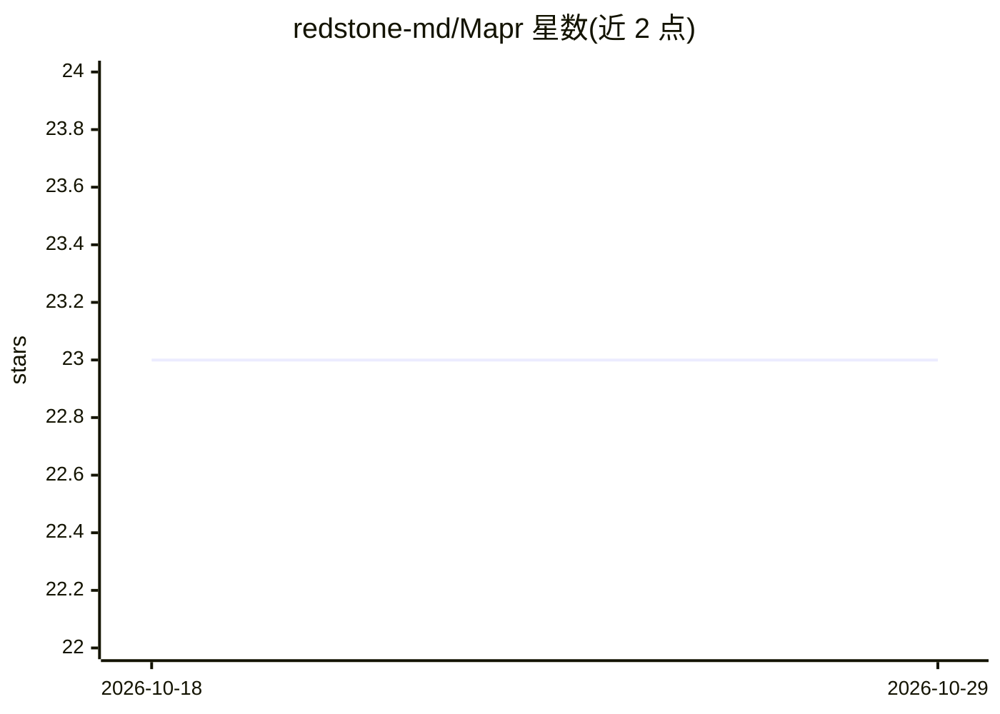

# redstone-md/Mapr

⭐ 23 · TypeScript · NOASSERTION · 推送 2026-05-07 · [GitHub](https://github.com/redstone-md/Mapr) · [官网](https://redstone.md/projects/mapr) · 组织维护

**AI 多智能体逆向分析前端站点的 CLI/TUI，产出 Markdown 报告**

基于 Bun 的 CLI/TUI 工具，用于前端网站与构建产物的逆向分析：同源爬取目标站点，收集 JS bundle、worker、service worker、WASM、source-map 等工件，将分块代码交给多智能体（scout/runtime/naming/security/synthesizer）AI 管线分析，生成含初始化流程、符号命名恢复、调用图推断、API/认证/指纹/加密面发现的 Markdown/HTML 报告。支持 OpenAI 及兼容端点、Codex CLI 认证、多家预设提供商；超大 bundle 可用本地词汇 RAG 模式，可选 Playwright 运行时追踪。许可证为 source-available 受限许可，非开源；AI 推断的调用图与重命名不具权威性。

## 筛选速览

| 维度 | 判定 | 备注 |
|---|---|---|
| AI 角色 | `ai-native` | 本体是模型或模型工具 |
| 许可风险 | `none` | NOASSERTION |
| 部署形态 | `library` | 以包/库形式分发 |
| 模型依赖 | — | README 未给出锁定关系 |
| 硬件要求 | — | 无带数字的原话,不猜 |
| 安装摩擦 | `low` | 无编译、无系统依赖或容器化 |
| 成熟度 | — | 结构信号不足 |

## 能力要点

- 同源爬虫发现 JS/WASM/source-map 工件并确定性提取 API/auth/captcha/指纹/加密面
- 五角色通信智能体 swarm 分块分析代码
- 本地词汇 RAG 模式处理数 MB 级 bundle，自动检测模型上下文窗口
- 可选 Playwright 水合后 DOM/网络/存储追踪，失败时保留部分报告

## 适用场景

- 逆向分析前端站点构建产物的结构与初始化流程
- 恢复混淆代码中的变量与函数命名
- 审计站点 API、认证、指纹与加密相关代码面

## 场景标签

`多智能体` `网页抓取` · 领域:Agent 开发

## 证据(README 行号)

> L5: Mapr is a Bun-native CLI/TUI for reverse-engineering frontend websites and build outputs. It crawls a target site, c
> L76: 8. Run a communicating swarm of analysis agents over chunked artifact content through streaming JSON generation so 

## 星数曲线

2026-10-18 23 → 2026-10-29 23（+0）

---
*卡片 v1 · prompt 1.4 · 生成 2026-10-27 · 置信度 high · 依据 README sha `87a7a931d864` · [字段定义](../../DATASET.md)*
