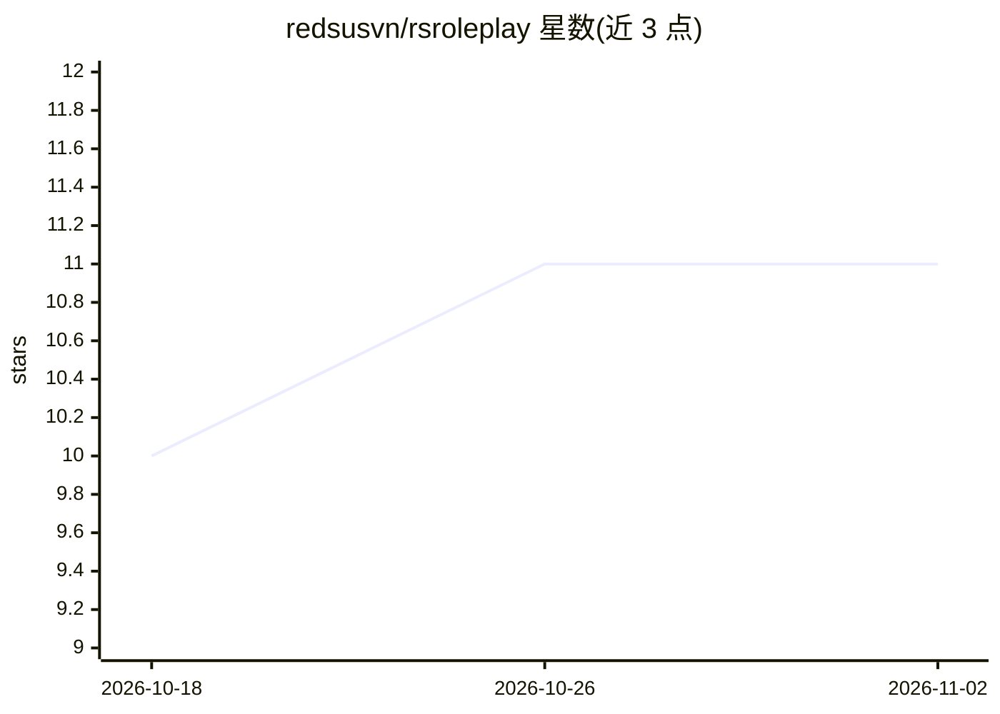

# redsusvn/rsroleplay

⭐ 11 · JavaScript · MIT · 推送 2026-10-26 · [GitHub](https://github.com/redsusvn/rsroleplay) · 个人维护

**部署在 Cloudflare Workers 上的自托管 AI 角色扮演聊天客户端**

完全运行在 Cloudflare Workers + D1 + Durable Objects 上的 serverless AI 角色扮演平台，也可当日常 AI 聊天客户端使用。支持接入 Groq、OpenRouter、Mistral、Cloudflare AI、Gemini 及任意 OpenAI 兼容 endpoint。消息在调用 AI 前先落库，回答流式写入数据库，断线自动重连续写；支持 reasoning 模型、角色卡管理、Character.AI 导入、多版本回答切换、消息摘要与记忆板。界面提供 10 种布局、240 种气泡样式与多层自定义。部署方式包括一键部署、wrangler 命令行与纯管理页 + Colab 脚本，免费套餐即可运行。

## 筛选速览

| 维度 | 判定 | 备注 |
|---|---|---|
| AI 角色 | `ai-native` | 本体是模型或模型工具 |
| 许可风险 | `permissive` | MIT |
| 部署形态 | `library` | 以包/库形式分发 |
| 模型依赖 | locked-api |  |
| 硬件要求 | — | 无带数字的原话,不猜 |
| 安装摩擦 | `low` | 无编译、无系统依赖或容器化 |
| 成熟度 | — | 结构信号不足 |

## 能力要点

- 消息先落库、流式写库，关闭浏览器后回答仍保留并续跑
- 多供应商接入：Groq/OpenRouter/Mistral/Cloudflare AI/Gemini 及 OpenAI 兼容 endpoint
- Durable Object 承载长回答生成（30 秒 CPU），断线自动重连续写
- 角色卡、记忆板、自动摘要、Character.AI 导入与 240 种气泡样式的界面自定义

## 适用场景

- 零服务器成本自建私人 AI 角色扮演站点
- 日常使用的多供应商 AI 聊天客户端
- 导入 Character.AI 角色卡继续对话

## 场景标签

 · 领域:AI 聊天/角色扮演应用

## 证据(README 行号)

> L5: *A lightning-fast, fully serverless AI roleplay platform powered by **Cloudflare Workers**, **Cloudflare D1** and **
> L39: - **🔌 Nhiều nhà cung cấp:** Groq, OpenRouter, Mistral, Cloudflare AI, Gemini, hoặc bất kỳ endpoint tương thích Open

## 星数曲线

2026-10-18 10 → 2026-11-02 11（+1）

---
*卡片 v1 · prompt 1.4 · 生成 2026-11-02 · 置信度 high · 依据 README sha `45ea14b5154d` · [字段定义](../../DATASET.md)*
