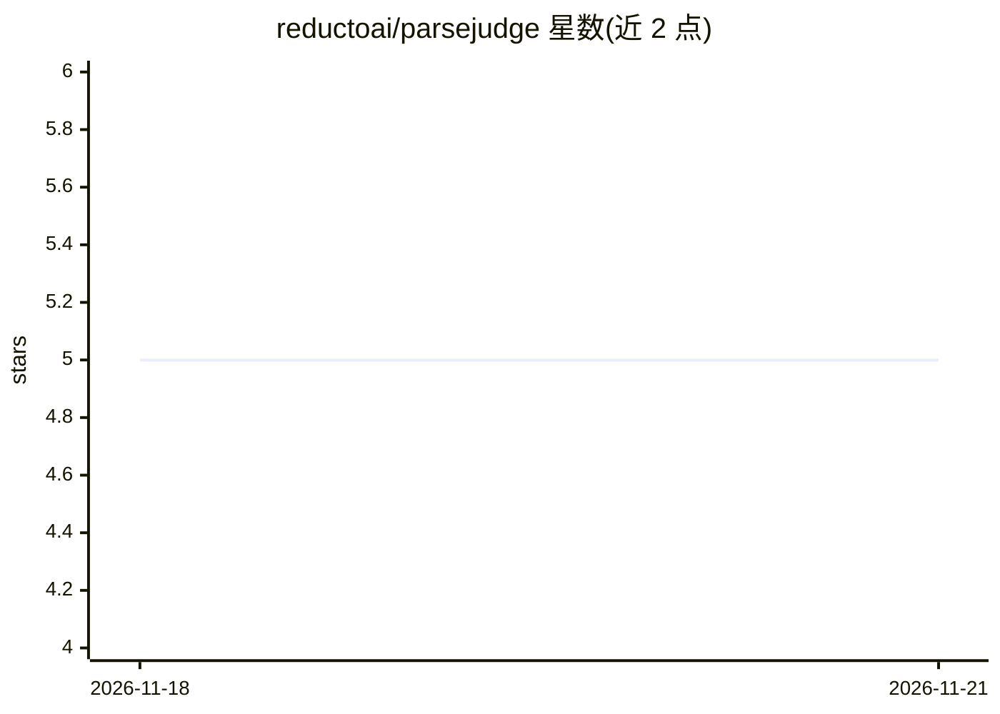

# reductoai/parsejudge

⭐ 5 · TypeScript · Apache-2.0 · 推送 2026-11-18 · [GitHub](https://github.com/reductoai/parsejudge) · 组织维护

**在自己的文档上对比各 PDF 解析/OCR API 的开源基准工具**

Parse Judge 将文档每页渲染为同一图像发送给多个解析服务商，用隐藏供应商名称的盲评 LLM（视觉模型）打分，生成含准确率、高严重错误、每千页成本、延迟与两两对比的可分享报告。支持 PDF/DOCX/PPTX（单次最多 1,000 页），判定提示词与评分代码开放在仓库中，可通过适配器插件接入新服务商；提供本地运行与自托管部署两种方式，并暴露 MCP 接口供 agent 客户端查询。

## 筛选速览

| 维度 | 判定 | 备注 |
|---|---|---|
| AI 角色 | `ai-ecosystem` | LLM/agent 周边工具 |
| 许可风险 | `permissive` | Apache-2.0 |
| 部署形态 | `library` | 以包/库形式分发 |
| 模型依赖 | locked-api |  |
| 硬件要求 | — | 无带数字的原话,不猜 |
| 安装摩擦 | `low` | 无编译、无系统依赖或容器化 |
| 成熟度 | — | 结构信号不足 |

## 能力要点

- 盲评机制：输出打乱且对 judge 隐藏供应商名称
- 同源输入：每页以同一渲染 PNG 发给所有服务商
- 逐页证据：每项评分附带错误列表及严重度定位
- MCP 服务器：可从 Claude/Cursor 等 MCP 客户端查询运行结果

## 适用场景

- 在自有文档上对比多家 PDF 解析 API 的准确率与成本
- 为文档处理流水线选型时获取逐页错误证据
- 自托管部署以在内部文档上运行解析基准

## 场景标签

`模型评测` `文档解析` `OCR` · 领域:评测与运维

## 证据(README 行号)

> L3: Compare PDF parsers and OCR APIs on **your own documents**. Parse Judge renders every page to the same image, sends
> L16: scoring code. Parse Judge runs any set of parsers on the documents you care about and shows the judge's reasoning
> L25: - **Agent-friendly.** Query runs from Claude, Cursor or any MCP client: `claude mcp add --transport http parsejudge

## 星数曲线

2026-11-18 5 → 2026-11-21 5（+0）

---
*卡片 v1 · prompt 1.4 · 生成 2026-11-21 · 置信度 high · 依据 README sha `93a4eacf8f94` · [字段定义](../../DATASET.md)*
