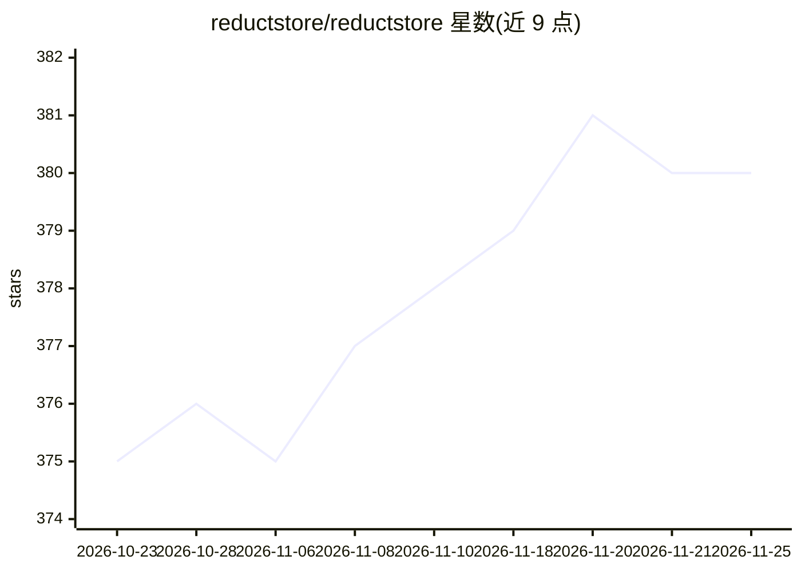

# reductstore/reductstore

⭐ 380 · Rust · Apache-2.0 · 推送 2026-11-23 · [GitHub](https://github.com/reductstore/reductstore) · [官网](https://www.reduct.store) · 组织维护

**面向机器人与工业 IoT 的时间索引对象存储**

ReductStore 是一个面向机器人与工业物联网场景的时间索引对象存储，将图像、视频、传感器读数、日志与 ROS bag 以原生二进制格式按时间戳组织，并用标签 enrich 每条记录。核心机制包括按时间范围与标签组合查询、基于容量的 FIFO 环形缓冲配额、按条目/标签条件的上游选择性复制，以及生命周期压缩与删除策略。安装以 Docker 镜像或 Linux 二进制包为主，另提供 Python 客户端示例；源码构建需 Rust 工具链（Cargo，内置 vendored protoc）。README 同时说明了不适用场景：纯数值数据、纯 blob 存储、消息队列需求。

## 筛选速览

| 维度 | 判定 | 备注 |
|---|---|---|
| AI 角色 | `ai-enhanced` | 去掉 AI 部分产品仍成立 |
| 许可风险 | `permissive` | Apache-2.0 |
| 部署形态 | `self-host` | docker 或自建部署 |
| 模型依赖 | — | README 未给出锁定关系 |
| 硬件要求 | — | 无带数字的原话,不猜 |
| 安装摩擦 | `low` | 无编译、无系统依赖或容器化 |
| 成熟度 | — | 结构信号不足 |

## 能力要点

- 按时间戳与标签组织二进制记录，支持时间+标签组合查询
- 基于容量的 FIFO 配额，把固定磁盘当作环形缓冲使用
- 按条目与标签条件向云端实例选择性复制数据
- 生命周期策略：历史数据先压缩再延迟删除

## 适用场景

- 机器人平台回放事故或模型失败前后的相机帧、遥测与日志
- 边缘设备保留有界本地历史，只把筛选出的数据转发到云端
- 工业场景统一替代时间序列库加对象存储的组合架构

## 场景标签

 · 领域:数据存储/机器人与工业IoT

## 证据(README 行号)

> L24: ReductStore is high-performance, time-indexed object storage for robotics and industrial IoT.
> L62: - Edge AI systems that need retention, labeling, and historical retrieval without building a custom storage stack

## 星数曲线

2026-10-23 375 → 2026-11-25 380（+5）

---
*卡片 v1 · prompt 1.4 · 生成 2026-11-25 · 置信度 high · 依据 README sha `83e8593b10b4` · [字段定义](../../DATASET.md)*
