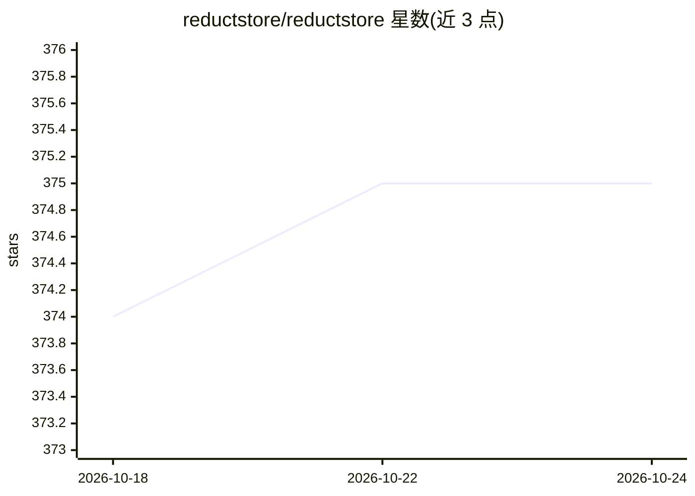

# reductstore/reductstore

⭐ 375 · Rust · Apache-2.0 · 推送 2026-10-21 · [GitHub](https://github.com/reductstore/reductstore) · [官网](https://www.reduct.store) · 组织维护

**面向机器人与工业物联网的时间索引对象存储**

ReductStore 是高性能、时间索引的二进制对象存储系统，用于持续接收机器人与工业设备产生的图像、视频、传感器数据、日志、文件和 ROS bag。每条记录按时间戳组织并可用标签丰富，支持按时间范围与标签查询、条件复制到上游实例、基于配额的 FIFO 磁盘管理与生命周期策略（保留/压缩/删除）。以 Docker 镜像或 Linux 二进制分发，也支持从 Cargo 源码构建。适用场景限定为带标签的连续二进制数据流；纯数值时序数据、纯 blob 或消息队列需求不适用。

## 筛选速览

| 维度 | 判定 | 备注 |
|---|---|---|
| AI 角色 | `ai-ecosystem` | LLM/agent 周边工具 |
| 许可风险 | `permissive` | Apache-2.0 |
| 部署形态 | `self-host` | docker 或自建部署 |
| 模型依赖 | — | README 未给出锁定关系 |
| 硬件要求 | — | 无带数字的原话,不猜 |
| 安装摩擦 | `low` | 无编译、无系统依赖或容器化 |
| 成熟度 | — | 结构信号不足 |

## 能力要点

- 时间戳+标签+二进制负载合为单条记录，按时间范围和标签查询
- 基于容量配额的 FIFO 环形缓冲，固定磁盘管理边界历史
- 按条目和标签条件选择性地向上游实例复制数据
- 生命周期策略支持保留、压缩与删除历史数据

## 适用场景

- 机器人平台回放事件或模型故障前后的相机帧、遥测与日志
- 边缘端收集二进制数据并仅转发筛选后的数据到云端
- 边缘 AI 系统的数据保留、标注与历史检索，免自建存储栈

## 场景标签

 · 领域:机器人/工业物联网数据存储

## 证据(README 行号)

> L24: ReductStore is high-performance, time-indexed object storage for robotics and industrial IoT.
> L62: - Edge AI systems that need retention, labeling, and historical retrieval without building a custom storage stack

## 星数曲线

2026-10-18 374 → 2026-10-24 375（+1）

---
*卡片 v1 · prompt 1.4 · 生成 2026-10-21 · 置信度 high · 依据 README sha `5817522cfa12` · [字段定义](../../DATASET.md)*
