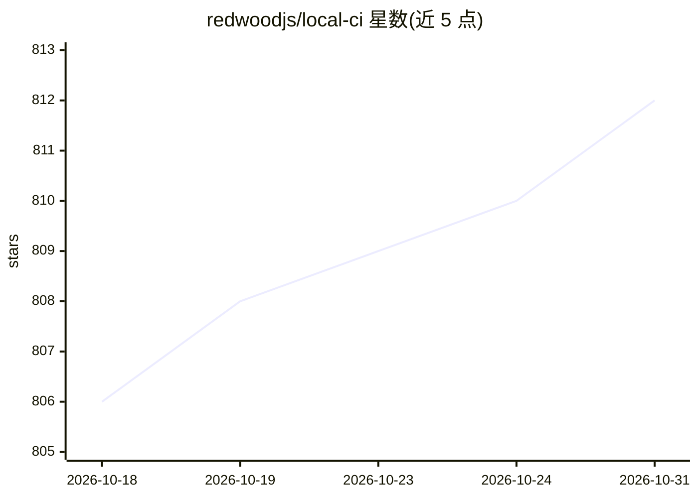

# redwoodjs/local-ci

⭐ 812 · TypeScript · NOASSERTION · 推送 2026-09-10 · [GitHub](https://github.com/redwoodjs/local-ci) · [官网](https://local-ci.dev) · 组织维护

**在本地机器上运行 GitHub Actions 的开发者工具**

在本地替换 GitHub Actions 的云端 API 层，让官方 runner 二进制在本机执行工作流：本地文件系统缓存（宣称约 0ms 往返）、失败时暂停容器保留状态、修复后仅重试失败步骤、直接对工作树运行无需提交。通过 npx 安装（TypeScript 执行路径），仓库内含 Rust runner 但未随 npm 发布。需要运行中的 Docker；macOS 任务需 tart 与 sshpass（可选）。提供面向 AI agent 的 NDJSON 输出与静默模式，兼容原 Agent CI 配置。

## 筛选速览

| 维度 | 判定 | 备注 |
|---|---|---|
| AI 角色 | `ai-enhanced` | 去掉 AI 部分产品仍成立 |
| 许可风险 | `none` | NOASSERTION |
| 部署形态 | `self-host` | docker 或自建部署 |
| 模型依赖 | — | README 未给出锁定关系 |
| 硬件要求 | — | 无带数字的原话,不猜 |
| 安装摩擦 | `low` | 无编译、无系统依赖或容器化 |
| 成熟度 | `idea` | |

## 能力要点

- 本地仿真 GitHub 服务端 API，运行未修改的官方 runner 二进制
- 失败时容器保活，修复后仅重试失败步骤
- 本地文件系统缓存与 lockfile 键控依赖快照（copy-on-write 克隆）
- NDJSON 事件流输出与 AI_AGENT 静默模式，供 AI agent 驱动

## 适用场景

- 提交前在本地预跑 CI，避免反复推送调试远程流水线
- CI 失败时暂停现场，本地修复后单步重试
- 让 AI agent 在 CI 失败时读取事件流、修复代码并重试

## 场景标签

 · 领域:开发工具/CI-CD

## 证据(README 行号)

> L7: Local CI is a ground-up rewrite of the GitHub Actions orchestration layer that runs entirely on your own machine. It
> L38: When a step fails, Local CI **pauses** instead of tearing down. The container stays alive with all state intact — e
> L114: |`--json`||Emit NDJSON event stream on stdout (also enabled by `LOCAL_CI_JSON=1`); see Agent output mode|

## 星数曲线

2026-10-18 806 → 2026-10-31 812（+6）

---
*卡片 v1 · prompt 1.4 · 生成 2026-10-21 · 置信度 mid · 依据 README sha `973342eac6de` · [字段定义](../../DATASET.md)*
