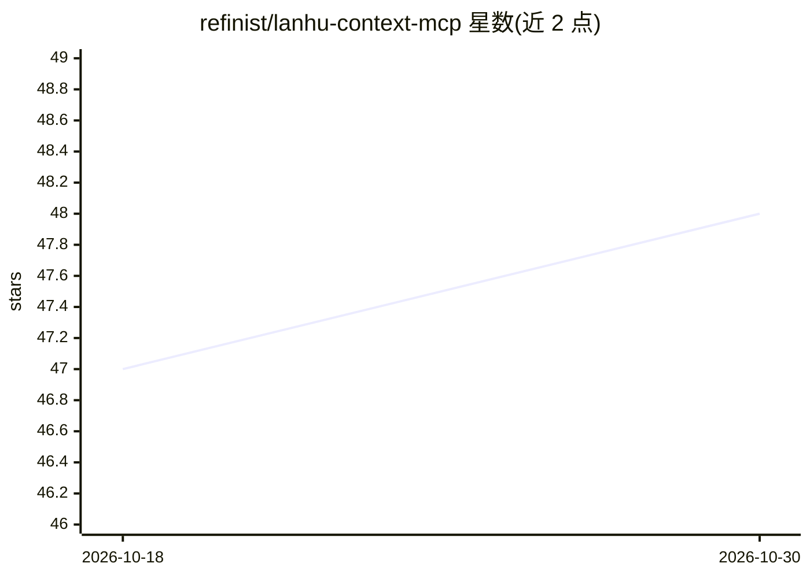

# refinist/lanhu-context-mcp

⭐ 48 · TypeScript · MIT · 推送 2026-10-14 · [GitHub](https://github.com/refinist/lanhu-context-mcp) · [官网](https://lanhu.refineup.com) · 组织维护 · 中文 README

**把蓝湖设计稿转成 AI 生成代码所需上下文的 MCP 服务器**

面向接入 MCP 的 AI 编程客户端（Claude Code/Cursor/Codex/TRAE/Qoder）的 MCP 服务器：读取蓝湖设计稿链接与 Token，产出 HTML+CSS 或 HTML+Tailwind 上下文、切图映射、Design Tokens、预览图与实现指引，供下游 AI 还原页面。提供 inline 与 files 两种产出模式，files 模式落盘打包以规避 MCP tool 输出 token 上限。需 Node.js 20.19+/22.12+，经 npx 启动，依赖配套的 Lanhu Helper 浏览器扩展复制 Token 与图层链接。

## 筛选速览

| 维度 | 判定 | 备注 |
|---|---|---|
| AI 角色 | `ai-ecosystem` | LLM/agent 周边工具 |
| 许可风险 | `permissive` | MIT |
| 部署形态 | `library` | 以包/库形式分发 |
| 模型依赖 | — | README 未给出锁定关系 |
| 硬件要求 | — | 无带数字的原话,不猜 |
| 安装摩擦 | `low` | 无编译、无系统依赖或容器化 |
| 成熟度 | — | 结构信号不足 |

## 能力要点

- 输出 HTML+CSS 或 HTML+Tailwind、Design Tokens 与切图资源映射
- inline/files 两种产出模式，files 落盘规避 MCP 输出 token 截断
- 面向下游 AI 的实现指引（优先级、适配方式、约束）
- 五种 MCP 客户端的配置示例（含 Windows 与各客户端 cwd 注意事项）

## 适用场景

- 把蓝湖设计稿链接发给 AI 编程客户端直接还原页面
- 按项目技术栈选择 HTML+CSS 或 Tailwind 输出形态
- 大设计稿超出 MCP 输出 token 上限时用 files 模式落盘交付

## 场景标签

`代码生成` · 领域:编码与开发

## 证据(README 行号)

> L7: ✨ 把蓝湖设计稿整理成让 AI 生成代码还原页面的上下文。
> L16: - 📦 提供 `inline` / `files` 两种产出模式：默认 `inline` 直接在 tool result 返回全部内容；`files` 把 HTML、切图映射、Design Tokens、Guide 打包成 `co
> L146: ### Step 4. 将蓝湖链接和提示词发给 AI

## 星数曲线

2026-10-18 47 → 2026-10-30 48（+1）

---
*卡片 v1 · prompt 1.4 · 生成 2026-10-25 · 置信度 high · 依据 README sha `c65f880028a4` · [字段定义](../../DATASET.md)*
